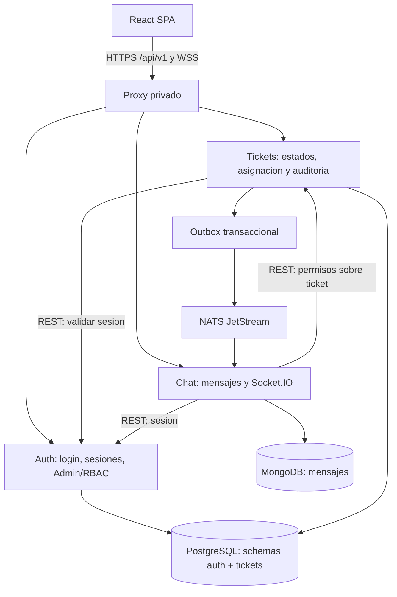

# 003 · Arquitectura vigente de FixIt (resumen)

**Producto:** piloto de Help Desk de TI **single-tenant para Keiser University LAC**. No hay cuentas de organizaciones múltiples, columna `tenant_id` ni integración con el directorio real de la universidad. El equipo respaldó conceptualmente Auth/Tickets/Chat, pero **no ha ratificado contratos ni infraestructura**. No existe código de producto.

## Recorrido de la demo

Reporter inicia sesión → crea ticket IT `OPEN` → Support Agent lo reclama **atómicamente** → conversa en el ticket → cambia a `IN_PROGRESS` y `RESOLVED` → Reporter confirma `CLOSED`. Admin administra cuentas, supervisa casos y reasigna excepcionalmente. Una foto y las notificaciones in-app son extras del MVP acotados, no otros servicios.

## Límites de los servicios

- **Auth:** usuarios individuales y sesiones opacas; cookies `HttpOnly; Secure; SameSite=Strict`, Argon2id, bootstrap del primer Admin en TTY privado, revocación real.
- **Tickets:** única autoridad de ownership/estado. Una **sola PostgreSQL** con esquemas `auth` y `tickets`, FK cruzadas y roles SQL separados. Claim con update condicionado, timeline/outbox en la misma transacción.
- **Chat:** MongoDB/Mongoose para historial. Verifica sesión con Auth y permisos actuales con Tickets **antes de leer, enviar o hacer broadcast**. Los mensajes confirmados sobreviven reconexión. Las nuevas operaciones del agente antiguo tras reasignación se rechazan.
- **NATS JetStream:** canal asíncrono elegido para eventos de tickets; outbox/inbox e idempotencia son **complejidad adicional asumida**, por medir antes de fijar G1. No sustituye REST sincrónico para seguridad.

## Infraestructura de demo

Una EC2 con Docker Compose y los runtimes anteriores, datos en EBS. Cloudflare Tunnel expone un único hostname sin puertos de entrada públicos por defecto. El usuario prefiere Spot **solo mientras se hacen pruebas**, y On-Demand temporal en caso de indisponibilidad para presentación. S3 privado **versiona releases por Git SHA** y conserva backups de PostgreSQL/MongoDB en prefijo distinto. AWS sigue sin aprovisionar ni validar costo; techo seleccionado: US$120 de créditos disponibles. [Detalle de operación](004.Cloud.md).

## Lo imprescindible antes de implementar

1. [Especificación COP3851](references/COP3851_Capstone_2026-11-11.md): **validar y commitear** OpenAPI y migración 3NF/FK antes de escribir controllers. [OpenAPI](openapi.json) y [migración](database/README.md) tienen commit inicial de borrador. **Redocly y Prisma CLI validaron sintaxis; SQL se ejecutó en PG17 efímero**, pero faltan revisión de equipo, comprobación Prisma/SQL y pruebas de roles/concurrencia.
2. [Contratos G1](010.G1-Contracts.md): revisar roles y flujos con Valeria y Rina, y confirmar con Félix solo la interpretación de single-tenant/BOLA si exige una columna literal.
3. Probar localmente memoria, Auth/Argon2id, claim realmente concurrente, permisos HTTP/Socket.IO, reconexión y DB restore antes de crear AWS. [Gates](011.Gates.md).

**No implementaremos por inercia:** IA Smart Triage, mantenimiento HVAC, dashboards avanzados, SLA, colas extra, cuarto microservicio, otras organizaciones o alta disponibilidad. Las alternativas anteriores de monolito modular y dos servicios están en el historial Git; su evaluación resumida vive en [006.Decisions](006.Decisions.md).
