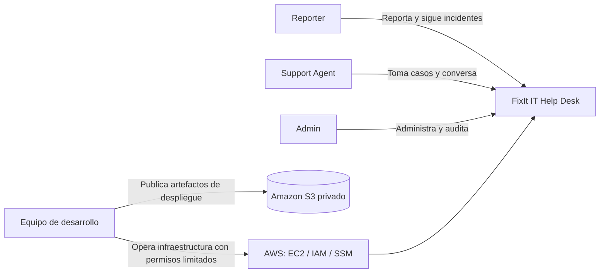
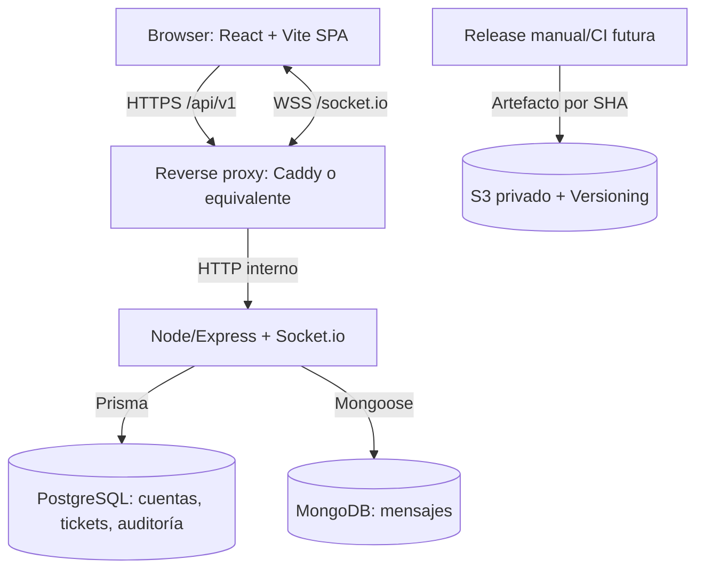
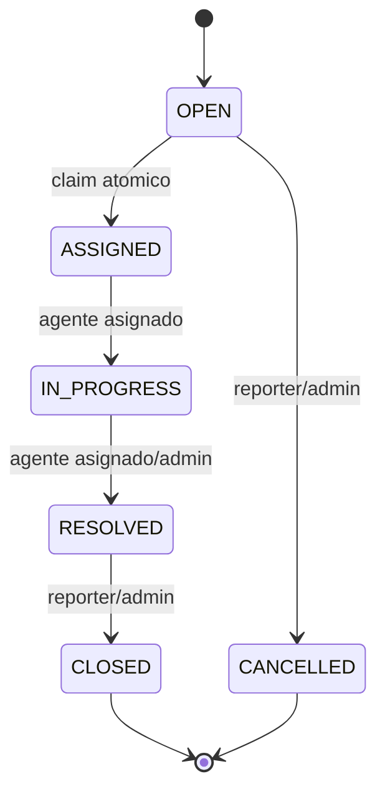
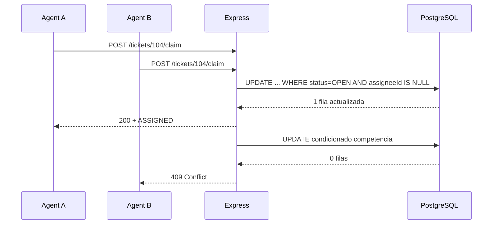

# 003 · Arquitectura técnica propuesta

**Estado:** diseño, no código implementado. **Esta vista representa la alternativa inicial de monolito modular, NO una arquitectura aprobada.** El 10-11-2026 el usuario expresó preferencia por **EDA con microservicios**. Antes de construir, comparar con el [candidato de dos servicios y broker](007.EDA-Evaluation.md) y el [ADR-004](adr/ADR-004-eda-two-services.md). El scope IT Help Desk sí está acordado.

## 1. Objetivos y restricciones

- Tres integrantes; entrega Web II durante la semana del 7 de diciembre de 2026; proyecto Cloud de caml07 y Valeria.
- Costo AWS cercano a cero en la práctica durante desarrollo, con límite explícito; sistema operativo local primero.
- Cubrir REST, middleware, auth/RBAC, relaciones SQL, NoSQL, pruebas, Socket.io, contenedores y API OpenAPI.
- La aplicación tiene una sola organización; se optimiza **simplicidad de implementación y enseñanza**, no alta disponibilidad empresarial.
- Ningún acceso directo desde el navegador a PostgreSQL/MongoDB ni credenciales AWS en cliente.

## 2. Vista de contexto



No hay integración requerida con Blackboard, correo institucional, Active Directory ni proveedores de IA.

## 3. Vista de contenedores lógicos (no equivale a contenedores Docker)



**Monolito modular API:** `auth`, `users`, `tickets`, `assignments`, `chat`, `audit` como módulos cohesivos; un runtime Express, un servidor HTTP y un Socket.io server. No API Gateway, Redis, Kafka, Lambda, Kubernetes ni microservicios en MVP.

**Estructura mínima sugerida al comenzar (aún no creada):**
```text
frontend/             React/Vite; vistas y consumo HTTP/Socket.io
backend/
  src/modules/         auth, tickets, chat, audit (módulos por negocio)
  prisma/              schema y migraciones PostgreSQL
infra/                 Compose, proxy y configuración de despliegue
docs/                  documentación canónica y ADR
compose.yaml           orquestación local, sin credenciales versionadas
```
Esta estructura inicial será **reemplazada por la de [008.Repository-Structure](008.Repository-Structure.md)** únicamente si se acepta ADR-004. No crear una arquitectura que mezcle ambas variantes por inercia; conservar el monolito como alternativa explícita.

**Interfaz pequeña entre módulos:** `claimTicket(ticketId,actorId)`, `authorizeTicketAction(actor,ticket,action)`, `saveMessage(ticketId,senderId,body,idempotencyKey)`, `transitionTicket(...)`. No crear servicios por cada tabla; escribir pruebas contra interfaces de negocio.

## 4. Datos e invariantes

### PostgreSQL (fuente de verdad del dominio)

| Tabla | Campos base | Restricciones |
| --- | --- | --- |
| `users` | id UUID, email, passwordHash, role, active, createdAt | email único case-normalized |
| `sessions` *si se elige sesiones* | id, userId, tokenHash, expiresAt, revokedAt | expiración y revocación server-side |
| `categories` | id, name, active | catálogo limitado IT |
| `tickets` | id UUID, ownerId FK, assigneeId FK nullable, categoryId FK, title, description, priority, status, createdAt, updatedAt, resolvedAt | assignee nulo al crear; check de prioridad/estado |
| `ticket_events` | id, ticketId FK, actorId FK, kind, fromStatus, toStatus, payload, createdAt | append-only; no borrado en cascada sin decisión |

Todos los cambios críticos de estado y `ticket_events` pertenecen a **una misma transacción PG**; no almacenar la historia crítica solo en MongoDB.

### MongoDB (conversación, si se acepta ADR-002)

Colección `messages`: `_id`, `ticketId` (UUID referencial a PG), `senderId` (UUID referencial a PG), `body` (texto), `clientMessageId`, `createdAt`. Índices `{ticketId: 1, createdAt: 1, _id:1}` y único `{ticketId:1, senderId:1, clientMessageId:1}`.

- No embedding ilimitado de todos los mensajes en un documento ticket.
- IDs externos en Mongo se validan contra PG. No existe FK ni transacción ACID entre motores.
- Los mensajes pueden paginarse por cursor estable `createdAt + _id`; límite inicial propuesto 50.
- Borrado de tickets: **deshabilitado** en MVP para preservar auditoría y conversación; cuando se requiera, diseñar retención y borrado coordinado.

### Máquina de estados



Si un Admin reasigna, mantiene el estado ASSIGNED o IN_PROGRESS y deja evento; no modifica mensajes anteriores. No reabrir en v1.

## 5. Camino crítico: claim concurrente



No garantizar cuál agente gana; **sí** garantizar que solo uno gana. Evitar patrón `SELECT` y luego `UPDATE` sin condición. En la misma transacción: actualizar ticket y escribir evento; emitir notificación **después** de commit. Si se cae la API entre commit y emisión, el cliente recupera estado mediante GET/refetch; no prometer entrega garantizada de eventos.

## 6. Camino crítico: chat por ticket

1. Cliente autentica sesión y solicita un ticket; backend valida `ticketId` y ownership/assignee.
2. Socket hace handshake con cookie autenticada y se une a la sala `ticket:{ticketId}` solo tras autorización.
3. `chat:send` incluye `ticketId`, texto validado (tamaño máximo propuesto: 2 KB) y `clientMessageId`. **No confiar en senderId recibido del navegador.**
4. El servidor **revalida** autorización y estado del ticket antes de persistir; Mongo guarda el mensaje, índice único deduplica reintentos y servidor confirma `chat:ack` con ID/fecha.
5. Servidor emite `chat:message` a los participantes autorizados. Ante reconexión, cliente hace GET paginado del historial. En RESOLVED/CLOSED/CANCELLED chat pasa a solo lectura; el agente anterior es expulsado o pierde autorización al reasignarse.
6. Si Mongo está caído: no ACK de éxito ni emisión de mensaje como si estuviera guardado. Ticketing puede seguir operando en PG; UI muestra fallo temporal de chat.

**Riesgo de carrera entre permiso y mensaje** si el Admin reasigna al mismo tiempo: primera mitigación simple es revalidar al enviar + revocar acceso socket al reasignar; prueba de seguridad obligatoria. Si es necesario orden total, definir una política más fuerte antes de producción; no afirmar transacción distribuida.

## 7. API REST mínima propuesta (contratos por formalizar en OpenAPI)

| Método y recurso | Rol principal | Acción |
| --- | --- | --- |
| POST `/api/v1/auth/login` | público | iniciar sesión |
| POST `/api/v1/auth/logout` | autenticado | revocar sesión |
| GET `/api/v1/auth/me` | autenticado | obtener identidad |
| GET/POST `/api/v1/tickets` | autorizado | listar/crear |
| GET `/api/v1/tickets/:id` | dueño/agente/admin | leer ticket autorizado |
| POST `/api/v1/tickets/:id/claim` | agente | autoasignación atómica |
| PATCH `/api/v1/tickets/:id/status` | según transición | cambiar estado |
| PATCH `/api/v1/tickets/:id/assignee` | admin | reasignar |
| GET `/api/v1/tickets/:id/events` | autorizado | timeline PG |
| GET `/api/v1/tickets/:id/messages` | autorizado | historial Mongo |
| GET `/health` | público limitado | salud superficial sin secretos |

Socket.io: `ticket:join`, `chat:send` (ACK), `chat:message` y `ticket:updated`. Son nombres **propuestos**, no contratos implementados. Respuestas JSON uniformes `{data, error, requestId}` a concretar; nunca introducir doble convención.

## 8. Seguridad transversal

- Identidad principal basada en cookie de sesión segura o JWT **según decisión pendiente**; ambos requieren diseño frente a CSRF, expiración y revocación. Propuesta Ponytail: **sesiones opacas en PG** para logout eficaz sin otra infraestructura; confirmar si el profesor exige JWT.
- Hash bcrypt para contraseñas por alineación con curso; rate limit de login; validación de datos y errores sin filtración de stack.
- HTTPS/WSS público (requiere resolver dominio/TLS); headers de seguridad, límites de cuerpo, escape de mensajes al renderizar, CORS restringido.
- Infraestructura interna: PostgreSQL/Mongo sin puertos públicos, secretos fuera de Git, logs sin contenido sensible.
- Modelo de amenazas mínimo: IDOR en tickets, auth bypass en sockets, carrera de claim, inyección, CSRF, fuga de mensajes, credenciales AWS, errores de configuración SG y backups.

## 9. Ausencias intencionales y validación

No se declara escalabilidad multi-instancia, cola confiable de eventos, alta disponibilidad ni recuperación instantánea. Un solo EC2 es punto único de fallo; se acepta como limitación académica si el equipo lo ratifica. Cualquier NFR p95 debe **medirse** antes de reportarlo.

Ver [004.Cloud](004.Cloud.md), [ADR-002](adr/ADR-002-polyglot-data.md) y [002.Requirements](002.Requirements.md).
