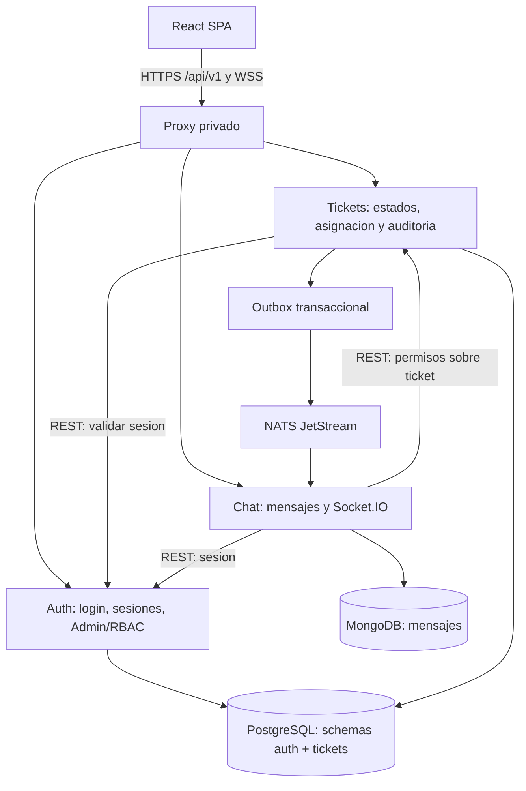

# 003 · Arquitectura vigente de FixIt (resumen)

**Producto:** piloto de Help Desk de TI **single-tenant para Keiser University LAC**. No hay cuentas de organizaciones múltiples, columna `tenant_id` ni integración con el directorio real de la universidad. El usuario congeló la baseline Contract-First 0.2.0 para implementación; la revisión técnica de Valeria/Rina sigue pendiente y no se atribuye su aprobación. **`dev` es documentación y contratos solamente**. `feat/chat` contiene un primer servicio Chat local con fixtures y pruebas; no equivale a integración con Auth/Tickets reales ni G4 completo. React aún no está creado. El prototipo Auth con pruebas se preserva en `prototype/auth-g4`.

## Recorrido de la demo

Reporter inicia sesión → crea ticket IT OPEN con **propuesta de urgencia** → Support Agent lo reclama atómicamente y **determina prioridad oficial manualmente** (Admin también puede hacerlo) → conversan → cambia a IN_PROGRESS y RESOLVED → Reporter confirma CLOSED. Admin gestiona cuentas y reasigna excepcionalmente. El formulario incluye hora automática, tag, descripción, urgencia y evidencia opcional según la baseline 0.2.0 congelada. Notificaciones in-app acotadas, sin servicios extra.

## Límites de los servicios

- **Auth:** usuarios individuales y sesiones opacas; cookies `HttpOnly; Secure; SameSite=Strict`, Argon2id, bootstrap del primer Admin en TTY privado, revocación real.
- **Tickets:** única autoridad de ownership/estado. Una **sola PostgreSQL** con esquemas `auth` y `tickets`, FK cruzadas y roles SQL separados. Claim con update condicionado, timeline/outbox en la misma transacción.
- **Chat:** MongoDB/Mongoose para historial. Verifica sesión con Auth y permisos actuales con Tickets **antes de leer, enviar o hacer broadcast**. Los mensajes confirmados sobreviven reconexión. Las nuevas operaciones del agente antiguo tras reasignación se rechazan.
- **NATS JetStream:** **se mantiene por decisión expresa del usuario**; canal asíncrono de eventos con outbox/inbox idempotentes y reintentos. G2 medirá recursos y G3 verificará recuperación, **no su eliminación**. La autorización sensible sigue siendo REST sincrónico, nunca un evento.

**Fase de desarrollo confirmada (18 nov):** servicios Auth/Tickets/Chat, React y JetStream **locales en contenedores**; RDS para PostgreSQL y Atlas para Mongo cuando haya permiso y conectividad segura; alternativa de ambas bases locales para CI/offline. No hay infraestructura remota creada. Este entorno es distinto del hosting final (EC2/Compose vs Fargate por decidir). [015 · Runbook híbrido](015.Hybrid-Development.md).

## Infraestructura de demo

**Baseline anterior (reabierto para comparación, no desplegado):** una EC2 con Compose, PostgreSQL/MongoDB/JetStream en EBS, Cloudflare Tunnel, S3 privado para releases/backups y Spot durante pruebas. **Nueva alternativa en evaluación (17 nov):** ECS Fargate para aplicaciones, RDS PostgreSQL y Atlas MongoDB; JetStream debe contar con almacenamiento duradero independiente. **S3 es destino de respaldos y versionado, NO el disco activo de JetStream**. La arquitectura final, red/egreso y costos siguen sin aprobar; el techo planeado es US$120 acumulados cubiertos solo con créditos realmente elegibles. [Comparación en Cloud 004](004.Cloud.md#11-alternativa-de-servicios-administrados-en-evaluacion-17-nov-2026).

## Lo imprescindible antes de implementar

1. [Especificación COP3851](references/COP3851_Capstone_2026-11-11.md): la baseline 0.2.0 está validada localmente, congelada por el usuario y commiteada en `dev` antes de cualquier commit de controladores. Redocly, Prisma validate, migraciones y diff se probaron en PostgreSQL 17 desechable. La migración incorpora restricciones SQL especiales no verificables por el diff; las pruebas de roles y concurrencia existentes son parciales/históricas. La revisión técnica del equipo y las pruebas de los servicios definitivos siguen pendientes.
2. [Contratos G1](010.G1-Contracts.md): revisar roles y flujos con Valeria y Rina, y confirmar con Félix solo la interpretación de single-tenant/BOLA si exige una columna literal.
3. Probar localmente memoria, Auth/Argon2id, claim realmente concurrente, permisos HTTP/Socket.IO, reconexión y DB restore antes de crear AWS. [Gates](011.Gates.md).

**No implementaremos por inercia:** IA Smart Triage, mantenimiento HVAC, dashboards avanzados, SLA, colas extra, cuarto microservicio, otras organizaciones o alta disponibilidad. Las alternativas anteriores de monolito modular y dos servicios están en el historial Git; su evaluación resumida vive en [006.Decisions](006.Decisions.md).
