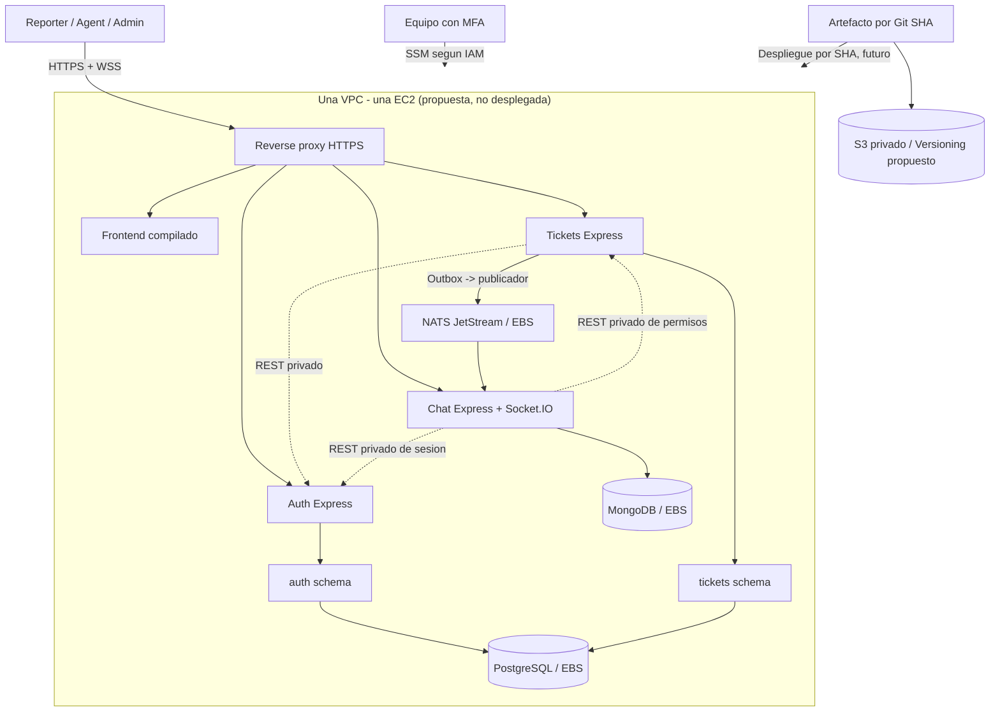

# 004 · Cloud — arquitectura AWS, seguridad, S3 y costos

**Diseño exclusivamente**: no existe cuenta AWS nueva, EC2, bucket, IAM, presupuesto ni factura verificada. Región de referencia de precios: **us-east-1 (N. Virginia)**, no seleccionada definitivamente. **El profesor Marvin sugirió S3 para la gestión de versiones llevadas a la nube**; aquí se propone un uso concreto para los releases.

**Confirmación comunicada por el usuario el 11 nov:** el profesor **Marvin acepta una VPC y una EC2** para este proyecto y **espera uso/evidencia de S3**. Es información oral reportada por el usuario; no tenemos rúbrica escrita que precise qué evidencia sustituye los ejercicios de dos VPC/VM. El PDF adicional de 23 páginas que describe dos VPC, peering y dos VM **no determina la topología vigente**. Para la revisión con Marvin del **12 nov** falta precisar si S3 debe alojar una **página estática pública**, **artefactos privados versionados**, o ambas cosas.

**Nueva confirmacion oral comunicada por el usuario el 12 nov:** Marvin dio **luz verde para continuar con la arquitectura Cloud** de FixIt. Considerar **desbloqueada la direccion general de una VPC/una EC2 para el trabajo de diseño**, sin inferir que ya aprobo el costo real, el tamano `t3.medium`, la modalidad exacta de S3, el manejo de credenciales ni la creacion efectiva de recursos AWS. G5 sigue sin despliegue ni PASS.

**Arquitectura candidata actual:** **tres servicios Auth/Tickets/Chat**, NATS JetStream, PostgreSQL con esquemas `auth`/`tickets`, MongoDB para mensajes y proxy HTTPS en **una EC2**. `t3.medium` (2 vCPU, 4 GiB) es una preferencia **no medida ni autorizada por presupuesto**. Los costos y rendimiento de la versión monolítica son solamente referencia histórica; G2 sigue pendiente.

**Hallazgo G2 (AWS oficial, 10 nov 2026):** [EC2 Free Tier eligible](https://docs.aws.amazon.com/AWSEC2/latest/UserGuide/ec2-free-tier-usage.html) para cuentas nuevas a partir del 15-07-2025 menciona `t3.small` y `t3.micro`, **no `t3.medium`**. Los [creditos Free Plan](https://docs.aws.amazon.com/awsaccountbilling/latest/aboutv2/free-tier-plans.html) tienen reglas distintas a la etiqueta Free-tier-eligible. Se debe verificar si la cuenta/plan permite lanzar la t3.medium o si requeriria Paid: **no desplegar ni subir de plan** por asumir que los creditos la cubren. La alternativa t3.small (2 GiB) necesita una prueba de recursos independiente.

## 1. Qué significa «AWS Free» en 2026

AWS ofrece a **clientes nuevos elegibles** plan Free: US$100 de crédito al registrarse y posibilidad de conseguir hasta US$100 adicional. Plan limitado hasta **seis meses o agotamiento de crédito**, lo que ocurra primero. No todos los servicios o features están disponibles en Free; no comprar servicios ni hacer upgrade a Paid sin aprobación.

**Punto crítico:** el usuario considera crear una cuenta nueva, pero AWS advierte que quienes ya tuvieron cuenta podrían **no ser elegibles** para nuevos créditos; verificar en consola antes de desplegar. No dar por garantizadas las cuotas históricas de EC2 t2/t3 «750 h/mes».

Fuentes: [AWS Free Plan](https://docs.aws.amazon.com/awsaccountbilling/latest/aboutv2/free-tier-plans.html), [FAQ](https://aws.amazon.com/free/free-tier-faqs/), [account creation](https://aws.amazon.com/resources/create-account/). Consultadas 2026-11-10.

## 2. Despliegue lean recomendado para aprobar/falsar

**Una EC2 Linux de tamaño a medir**, con contenedores de proxy, frontend estático, **Auth, Tickets, Chat, PostgreSQL, MongoDB y NATS JetStream**. El reverse proxy es el único componente expuesto públicamente. Auth y Tickets comparten una base PostgreSQL, pero cada uno conserva su esquema y permisos. S3 para releases es un flujo separado del tráfico de tickets. La instancia única es **punto único de fallo**, no alta disponibilidad.



### Red y conectividad

- Usar VPC simple y una subnet con ruta a Internet Gateway para la EC2 *si es necesaria exposición web*. La EC2 puede tener IPv4 pública; **no abrir puertos DB 5432/27017, SSH 22 ni la API interna en SG**. Abrir 443 y, solo si hace falta para certificado/redirección, 80; definir origen para el demo.
- Para SSM, la instancia necesita el agente, rol de instancia y **salida hacia endpoints de Systems Manager**. Con IPv4 pública + Internet Gateway y sin SSH entrante se evitan inicialmente los costos de NAT Gateway/Interface Endpoints. Esto no convierte la instancia en «subred privada» y la IP pública puede cambiar al detener/reiniciar la instancia; documentar cómo se actualiza DNS.
- En Compose, mapear al host solo 80/443 del reverse proxy; PG, Mongo y API quedan en red interna Docker. Para SSM port forwarding al motor, usar forwarding a `127.0.0.1` solo mediante bind de loopback o un proxy local de puerto mínimo; **no asumir que un contenedor sin publicación puede alcanzarse en 127.0.0.1 del host**.
- HTTPS con DNS válido antes de exposición pública. Certificados automáticos requieren hostname y conectividad válida; si no hay dominio, la demo será local/SSM o requerirá mecanismo alternativo aprobado. No exponer login por HTTP público.
- No ALB, NAT Gateway, RDS, ECS, CloudFront, API Gateway ni VPN en MVP por defecto. Añadir solo si hay rúbrica/beneficio y presupuesto verificado.

## 3. IAM y colaboración: tres identidades, una infraestructura

**Cloud académico:** caml07 y avaleria13. **Rina no cursó Cloud**, pero colabora en desarrollo y acceso remoto a DB.

| Capacidad | caml07 / Valeria | Rina |
| --- | --- | --- |
| Login AWS individual con MFA | Sí | Sí |
| Iniciar la EC2 identificada | Sí | Sí, política acotada |
| Ver estado de EC2 identificada | Sí | Sí |
| Túnel SSM para DB | Sí | Sí, restringido a instancia/documento |
| Lectura/escritura datos de desarrollo | Rol DB individual | Rol DB individual |
| Administrar IAM/red/buckets | Administradores designados con permisos necesarios | No |
| Detener instancia compartida | Solo responsables operativos designados | No inicialmente |
| Root AWS | Solo para tareas de root imprescindibles, sin compartir | No |

Elegir IAM Identity Center y credenciales temporales **si es compatible con el plan**; de no ser posible, evaluar identidades IAM individuales con MFA y sin claves persistentes. Separar rol AWS de los permisos SQL/Mongo. No dar `AdministratorAccess` global solo por ser responsable de Cloud.

Sesiones remotas: [Session Manager port forwarding](https://docs.aws.amazon.com/systems-manager/latest/userguide/session-manager-working-with-sessions-start.html). Verificar condiciones para restringir acceso a documento de túnel, SSM API y target. Los túneles no proporcionan auditoría del contenido de consultas: complementar con logs DB selectivos.

## 4. S3: ¿qué versionar exactamente?

**Punto para Marvin (12 nov; aun no respondido):** el PDF de adaptacion
propone una **landing page publica en S3 Static Website Hosting**. Nuestro
uso elegido antes de esa propuesta era **S3 privado con Versioning de
artefactos**. El usuario confirmo que Marvin espera S3, **pero no especifico
en este intercambio cual de los dos productos o si ambos**. No equiparar
"versioning" con "public static hosting". El endpoint nativo de website
en S3 **no admite HTTPS**; si hay que servir una pagina publica segura
evaluar CloudFront con bucket privado, y revisar costo/permisos antes
de incorporarlo. **No montar login, sesiones ni formulario sensible sobre
un website S3 de HTTP plano.** Referencias:
[AWS Website Endpoints](https://docs.aws.amazon.com/AmazonS3/latest/userguide/WebsiteEndpoints.html),
[AWS S3 Access Control](https://docs.aws.amazon.com/AmazonS3/latest/userguide/access-management.html).

**Git/GitHub** guarda código fuente y documentación (`main`, `dev`, commits, PRs). **S3 Versioning** guarda artefactos de *release* (**no repos Git clonados enteros** ni historiales sustitutos).

Estructura lógica propuesta de un bucket privado:
```text
s3://<bucket-privado-fixit>/
  releases/<git-sha>/fixit-release.tar.gz
  releases/current.json
  evidence/<fecha>/deployment-manifest.json
```

- `releases/<sha>/...` es inmutable por convención: archivo que corresponde al SHA de commit, fecha, checksum y versión de imagen/artefacto. No escribir claves, tokens, secretos ni bases personales en él.
- `releases/current.json` se sobrescribe en cada deploy: **S3 Versioning** permite mostrar/restaurar una versión anterior del manifiesto. El rollback del **servicio real** requiere también redeploy de ese SHA y compatibilidad de esquema DB; restaurar solo el JSON no revierte aplicación ni datos.
- Activar **Block Public Access**, cifrado en reposo con configuración por defecto del bucket (SSE-S3 suficiente para MVP; KMS si requisito), acceso IAM mínimo y bucket en región de la EC2. Objeto versionado **no es por sí mismo backup de base de datos**.
- Aplicar Lifecycle a versiones anteriores de `current.json` (ej. expiración a los 14 días **propuesta**, no configurada). Evitar crecimiento de versiones; AWS factura **cada versión completa**, no un diff. Antes de borrar no-current versions confirmar que no se destruye una evidencia requerida para presentación.
- Separar backups PostgreSQL/Mongo: export consistente, cifrado y prueba de restore. Un segundo prefijo de S3 con acceso más estricto podría alojarlos, pero **no subir datos reales sin decisión de retención, cifrado y permisos**.

Fuentes: [S3 Versioning](https://docs.aws.amazon.com/AmazonS3/latest/userguide/Versioning.html), [S3 Lifecycle](https://docs.aws.amazon.com/AmazonS3/latest/userguide/intro-lifecycle-rules.html), [precios S3](https://aws.amazon.com/s3/pricing/).

## 5. Estimación de costo: ESCENARIOS, no factura

Referencias AWS públicas us-east-1: EC2 Linux **t3.small 2 GiB ~US$0.0209/h**, **t3.medium 4 GiB ~US$0.0418/h**; EBS gp3 **~US$0.08/GB-mes**, IPv4 pública **US$0.005/h**. Datos públicos consultados el 10-11-2026. Los tipos t3 pueden tener costos por CPU burst en Unlimited, verificar configuración.

| Escenario ilustrativo | Cálculo compute (EC2) | EBS 20 GB por mes | IPv4 pública mientras corre | Subtotal aprox. |
| --- | ---: | ---: | ---: | ---: |
| t3.small, 120 h/mes | 120 × 0.0209 = $2.51 | $1.60 | 120 × 0.005 = $0.60 | **$4.71** |
| t3.medium, 120 h/mes | 120 × 0.0418 = $5.02 | $1.60 | $0.60 | **$7.22** |
| t3.medium, 730 h/mes | 730 × 0.0418 = $30.51 | $1.60 | 730 × 0.005 = $3.65 | **$35.76** |

**Excluye:** costo de transferencia saliente, S3/versiones/operaciones, snapshots/backups, dominio/DNS, logs y CloudWatch, CPU burst, impuestos, otras IPs, KMS, endpoints, y cualquier carga adicional. No descontar créditos sin comprobar elegibilidad. El estado de un volumen EBS detenido sigue generando gastos de almacenamiento; una IPv4 fija en reserva puede seguir cobrando. **Son comparaciones, no cotización ni garantía de USD 0.**

**Recomendación de simplicidad:** medir localmente la RAM de **Auth + Tickets + Chat + PostgreSQL + MongoDB + NATS** antes de elegir tamaño. `t3.medium` es candidata, no garantía de capacidad. Confirmar instancia disponible y precio con [AWS Pricing Calculator](https://calculator.aws/#/), con ayuda del profesor Marvin; revisar consumo de CPU credits T3.

## 6. Guardrails de presupuesto y cierre

Antes de lanzar: habilitar MFA, revisar Free/Paid plan, registrar un solo owner de billing, configurar AWS Budgets con notificaciones para consumo estimado (p. ej. objetivos internos **$5/$10/$20** para advertencias, sujetos a aprobación), revisar créditos en Billing; las alertas **no detienen automáticamente cargos** si se usa Paid. No asociar cuenta a Organizations ni activar plan pago sin revisar consecuencias.

Fuentes: [AWS Budgets](https://aws.amazon.com/aws-cost-management/aws-budgets/pricing/), [VPC public IPv4/NAT](https://aws.amazon.com/vpc/pricing/), [EC2 t3](https://aws.amazon.com/ec2/instance-types/t3/), [EBS gp3](https://aws.amazon.com/ebs/volume-types/), [EC2 calculator](https://docs.aws.amazon.com/pricing-calculator/latest/userguide/ec2-estimates.html).

- La instancia común: cualquier integrante puede consultar/encender según IAM, **solo encargados autorizados pueden apagar** después de coordinarse; no apagar durante demo.
- Disponibilidad de demo: preferir mantener la instancia en ejecución el día de evaluación y tener video/screenshots **como evidencia complementaria**; no son sustituto de demo funcional si la rúbrica exige acceso.
- Al concluir: exportar backups/evidencias necesarios, eliminar EC2, volúmenes, snapshots, bucket versions no requeridas, IPs reservadas, alarmas y recursos fuera de uso; verificar factura.
- **Riesgo central:** un solo host significa corte de DB y API al apagarlo, aunque existan bases lógicas dev/demo. No presentar esto como alta disponibilidad.

## 7. Verificaciones pendientes antes de ejecutar

1. Elegibilidad exacta de una cuenta nueva (registro anterior AWS podría invalidar créditos).
2. Servicio EC2/SSM/S3/Identity Center disponible para la cuenta Free en la región deseada.
3. Política de datos demo y si se exige sitio web públicamente accesible con dominio HTTPS.
4. Resultado de prueba de memoria local con ambos motores; tamaño y horario de EC2.
5. Cost estimate completo con Marvin (incluye IP, EBS, almacenamiento S3/versiones y tráfico).
6. Ensayar prueba real de SSH cerrado, DB cerrado, SSM funcional, acceso Rina limitado, restore y rollback; **ninguno probado hoy**.

## 8. Paquete de decisiones intermedias AWS (12 nov; para reunion de equipo)

**Propuestas tecnicas, no decisiones aceptadas por Valeria/Rina ni recursos
creados.** Mantener los tres servicios Auth/Tickets/Chat, PostgreSQL con
dos schemas, MongoDB para Chat y NATS JetStream; no abrir un gate nuevo.

| Tema | Default minimo propuesto | Condicion para fijarlo |
| --- | --- | --- |
| **Topologia de ejecucion** | **Una EC2 / un despliegue Compose** con proxy + web estatica + tres runtimes Node + PostgreSQL + MongoDB + NATS. Contenedores separados; no EKS/ECS/RDS/Atlas/ALB por defecto | Verificar en G2 consumo real y compatibilidad local/EC2 del motor Compose elegido |
| **Red interna y exposicion** | Una VPC, subnet publica para la EC2 si hay demo web, **solo 443** al proxy (80 temporal para redireccion/ACME si procede); no exponer 22, 5432, 27017, 4222 ni puertos de servicios | Confirmar si la demo necesita URL publica y un hostname/certificado HTTPS valido. Si no, demo local o acceso controlado, nunca login publico en HTTP |
| **Acceso AWS y S3** | Usuarios AWS individuales con MFA; **SSM** para administrar la EC2 sin abrir SSH; rol de instancia con permisos minimos al bucket privado, **sin access keys persistentes** | Verificar IAM role, SSM Agent y salida de red antes de cerrar 22; confirmar si la cuenta permite esas herramientas |
| **Datos duraderos** | Volumen/es **EBS cifrados** con rutas persistentes separadas para PostgreSQL, MongoDB, NATS JetStream y, si se decide, fotos privadas. JetStream en **file storage**, no en RAM ni `/tmp` | Prueba de reinicio/caida y de integridad; backups logicos PG/Mongo + restore ensayado. Snapshot EBS no sustituye por si solo backup consistente de la app |
| **S3 y fotos** | Primero S3 **privado + Versioning para releases**; foto opcional de ticket con almacenamiento privado sujeto a permisos, local en EBS o S3 segun necesidad real | Marvin debe precisar website estatico vs versionado; el equipo decide donde guardara fotos. No publicar fotos para demostrar S3 |
| **Despliegue/reversion** | Release **manual y reproducible por commit SHA**, con migraciones Prisma coordinadas y verificadas **antes del arranque del producto**; nunca ejecutar migradores independientes al arrancar Auth/Tickets | Contrato OpenAPI + 3NF/FK/migraciones en Git **antes de controllers** (Felix); ensayo de deploy, reinicio y rollback de app, diferenciando rollback de DB |
| **Operabilidad y costo** | Logs estructurados sin secretos, endpoint de health/readiness por servicio, limites/observacion de RAM y disco, alarmas basicas, presupuesto y cleanup | G2 local sobre producto; validar elegibilidad/costo de EC2/EBS/S3/IPv4/logs. No suponer Free Tier ni activar plan de pago |

**Orden de prueba propuesto (sin provisionar AWS ahora):**
1. **G1** — Valeria/Rina revisan este paquete y los contratos de servicios;
   definir si hay demo publica, S3 requerido y manejo de persistencia.
2. **G4 / Contract-First** — commit de OpenAPI + 3NF/FK/migraciones
   **anterior a controllers**; un solo responsable de migraciones
   PostgreSQL (Prisma) y colecciones Chat/Mongoose.
3. **G2 en local** — arrancar stack completo con Compose, medir memoria/CPU
   y almacenamiento, simular reinicio y caida de NATS/Chat y restauracion.
4. **G3** — permisos HTTP/Socket.IO, reasignacion de agente, CSRF/Origin,
   expiracion de sesiones, foto privada, REST fail-closed y reentrega de
   eventos; evidencia de red team sobre el producto.
5. **G5** — **solo con autorizacion expresa de cuenta y costos**,
   provisionar red/SG/EC2/rol/bucket, confirmar SSM+TLS, desplegar release,
   capturar pruebas y cerrar con cleanup seguro.

**Tres dudas que SI cambian la decision Cloud:** (a) demo publica y
dominio/certificado, (b) requisito preciso de S3 — releases, web estatica
o ambos — y almacenamiento de fotos, (c) limite real de presupuesto/RAM.
El resto puede seguir un default seguro y reversible durante desarrollo.

**Fuentes para verificar en implementacion:**
[AWS Session Manager](https://docs.aws.amazon.com/systems-manager/latest/userguide/session-manager.html),
[AWS roles EC2 y S3](https://docs.aws.amazon.com/IAM/latest/UserGuide/id_roles_use_switch-role-ec2.html),
[EBS Snapshots](https://docs.aws.amazon.com/ebs/latest/userguide/ebs-snapshots.html),
[NATS JetStream](https://docs.nats.io/concepts/jetstream).
