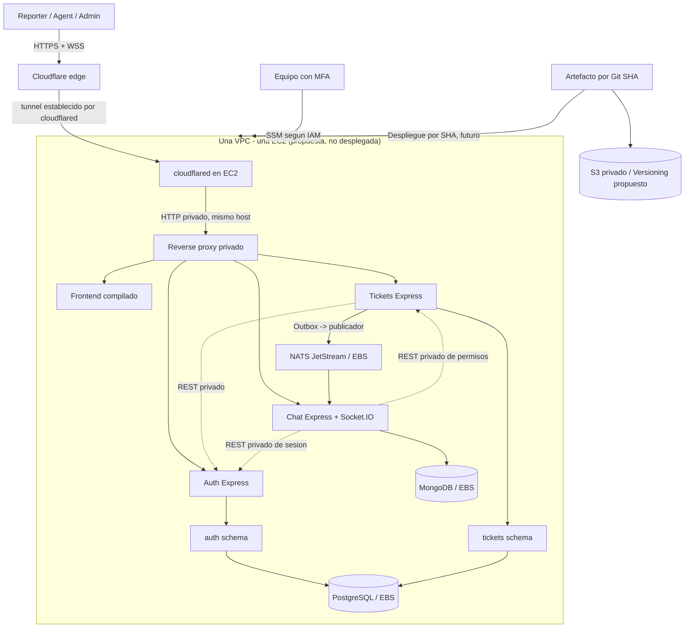
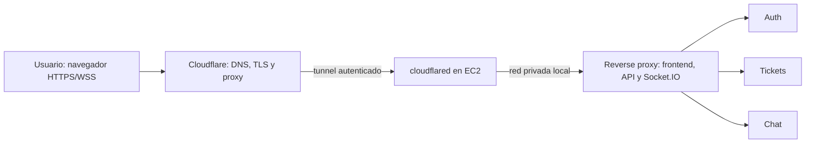

# 004 · Cloud — arquitectura AWS, seguridad, S3 y costos

**Diseño exclusivamente**: no existe cuenta AWS nueva, EC2, bucket, IAM, **saldo de creditos comprobado** ni factura verificada. El usuario acordo **US$120 de consumo total en creditos AWS** para FixIt, sin autorizar despliegue ni pago personal. Región de referencia de precios: **us-east-1 (N. Virginia)**, no seleccionada definitivamente. **El usuario confirmo el 15 nov que Marvin les pidio usar S3 para versionar la aplicacion**; se adopta el bucket privado con Versioning para releases, no un segundo website publico.

**Confirmación comunicada por el usuario el 11 nov:** el profesor **Marvin acepta una VPC y una EC2** para este proyecto y **espera uso/evidencia de S3**. Es información oral reportada por el usuario; no tenemos rúbrica escrita que precise qué evidencia sustituye los ejercicios de dos VPC/VM. El PDF adicional de 23 páginas que describe dos VPC, peering y dos VM **no determina la topología vigente**. **Aclaracion posterior (15 nov):** Marvin pidio S3 Versioning de la aplicacion, segun confirmacion del usuario. El bucket privado de releases quedo seleccionado; falta verificar evidencias y entregables Cloud, no reabrir hosting S3 por inercia.

**Nueva confirmacion oral comunicada por el usuario el 12 nov:** Marvin dio **luz verde para continuar con la arquitectura Cloud** de FixIt. Considerar **desbloqueada la direccion general de una VPC/una EC2 para el trabajo de diseño**, sin inferir que ya aprobo el costo real, el tamano `t3.medium`, la modalidad exacta de S3, el manejo de credenciales ni la creacion efectiva de recursos AWS. G5 sigue sin despliegue ni PASS.

**Revision de Valeria (comunicada el 15 nov):** ve bien la direccion Cloud, pero advierte del riesgo de **incurrir en gastos**. El usuario fijo **techo de planificacion de US$120 de uso de creditos AWS**, pero no autorizo aun lanzar recursos ni un upgrade Paid. Comprobar elegibilidad de recursos y costo real antes de desplegar. Verificar los cargos **que persisten con EC2 detenida**, incluidos EBS, objetos/versiones S3 y recursos IPv4 segun su estado; monitorizar consumo y planear cleanup.

**Arquitectura candidata actual:** **tres servicios Auth/Tickets/Chat**, **NATS JetStream reafirmado por usuario**, PostgreSQL con esquemas `auth`/`tickets`, MongoDB para mensajes y proxy HTTPS en **una EC2**. El usuario eligio **EC2 Spot `persistent` con EBS y `stop` en interrupciones**, encendida solo durante pruebas y apagada manualmente, en vez de 24/7; la capacidad regional, el posible reinicio automatico y la elegibilidad de la cuenta se comprobaran antes de desplegar. `t3.medium` (2 vCPU, 4 GiB) es una preferencia **no medida ni autorizada por presupuesto**. Los costos y rendimiento de la versión monolítica son solamente referencia histórica; G2 sigue pendiente.

**Hallazgo G2 (AWS oficial, 10 nov 2026):** [EC2 Free Tier eligible](https://docs.aws.amazon.com/AWSEC2/latest/UserGuide/ec2-free-tier-usage.html) para cuentas nuevas a partir del 15-07-2025 menciona `t3.small` y `t3.micro`, **no `t3.medium`**. Los [creditos Free Plan](https://docs.aws.amazon.com/awsaccountbilling/latest/aboutv2/free-tier-plans.html) tienen reglas distintas a la etiqueta Free-tier-eligible. Se debe verificar si la cuenta/plan permite lanzar la t3.medium o si requeriria Paid: **no desplegar ni subir de plan** por asumir que los creditos la cubren. La alternativa t3.small (2 GiB) necesita una prueba de recursos independiente.

## 1. Qué significa «AWS Free» en 2026

AWS ofrece a **clientes nuevos elegibles** plan Free: US$100 de credito inicial y **hasta US$100 adicionales por actividades**. US$200 es maximo posible, no saldo garantizado. Plan Free limitado a seis meses o agotamiento de credito, lo que ocurra primero. No todos los servicios o features están disponibles en Free; no comprar servicios ni hacer upgrade a Paid sin aprobación.

**Punto crítico:** el usuario considera crear una cuenta nueva, pero AWS advierte que quienes ya tuvieron cuenta podrían **no ser elegibles** para nuevos créditos; verificar en consola antes de desplegar. No dar por garantizadas las cuotas históricas de EC2 t2/t3 «750 h/mes».

Fuentes: [AWS Free Plan](https://docs.aws.amazon.com/awsaccountbilling/latest/aboutv2/free-tier-plans.html), [FAQ](https://aws.amazon.com/free/free-tier-faqs/), [account creation](https://aws.amazon.com/resources/create-account/). Consultadas 2026-11-10.

## 2. Despliegue lean recomendado para aprobar/falsar

**Una EC2 Linux de tamaño a medir**, con contenedores de proxy, frontend estatico, **Auth, Tickets, Chat, PostgreSQL, MongoDB y NATS JetStream**. El proxy sirve el sitio y la API, **pero no abre puertos de entrada desde Internet**; el hostname publico llega por Cloudflare Tunnel nombrado. Auth y Tickets comparten una base PostgreSQL, pero cada uno conserva su esquema y permisos. S3 para releases es un flujo separado del tráfico de tickets. La instancia única es **punto único de fallo**, no alta disponibilidad.



### Red y conectividad

- Usar una VPC simple. Como **se eligio Cloudflare Tunnel**, no abrir puertos entrantes 22, 80, 443, 5432, 27017, 4222 ni API interna en el security group por defecto. Comprobar que EC2 tiene salida al borde de Cloudflare para `cloudflared`, al registro de imagenes y a SSM; la topologia de subnet, IPv4/IPv6 y posible NAT requiere cotizacion.
- Para SSM, la instancia necesita el agente, rol y **salida hacia endpoints de Systems Manager**. Una EC2 con IPv4 publica e Internet Gateway es una opcion de egreso; una subnet sin IPv4 publica necesita **otra salida comprobada** (por ejemplo IPv6 viable o NAT, con costos diferentes). El hostname de Tunnel no depende de que la IPv4 de EC2 sea estable.
- En Compose, vincular el reverse proxy solo a loopback o la red privada del contenedor `cloudflared`; **no** publicar 80/443 en todas las interfaces. PG, Mongo, NATS y APIs internas quedan en Docker privado. Para SSM port forwarding, usar bind de loopback o proxy local restringido; no asumir que un contenedor sin publicacion es accesible por `127.0.0.1` del host.
- Validar delegacion del dominio a Cloudflare DNS y certificado HTTPS del borde antes de publicar login. El tramo `cloudflared -> proxy` puede usar HTTP **solo dentro del mismo host/red privada de Compose**, sin exponerse a Internet; si se separan los hosts, evaluar TLS al origen. Mantener un solo hostname para `/api/v1` y `/socket.io` con WSS.
- No ALB, RDS, ECS, CloudFront, API Gateway ni VPN por defecto. **No excluir NAT por decreto**: si la EC2 no tiene otra salida funcional, el presupuesto puede exigir cambiar la topologia. Añadir solo con rubrica, necesidad real y presupuesto aprobado.

## 3. IAM y colaboración: tres identidades, una infraestructura

**Cloud académico:** caml07 y avaleria13. **Rina no cursó Cloud**, pero colabora en desarrollo y acceso remoto a DB.

| Capacidad | caml07 / Valeria | Rina |
| --- | --- | --- |
| Login AWS individual con MFA | Sí | Sí |
| Iniciar la EC2 identificada | Sí | Sí, política acotada |
| Ver estado de EC2 identificada | Sí | Sí |
| Túnel SSM para DB | Sí | Sí, restringido a instancia/documento |
| Lectura/escritura datos de desarrollo | Rol DB individual | Rol DB individual |
| Administrar IAM/red/buckets | Administradores designados con permisos necesarios | No |
| Detener instancia compartida | Solo responsables operativos designados | No inicialmente |
| Root AWS | Solo para tareas de root imprescindibles, sin compartir | No |

Elegir IAM Identity Center y credenciales temporales **si es compatible con el plan**; de no ser posible, evaluar identidades IAM individuales con MFA y sin claves persistentes. Separar rol AWS de los permisos SQL/Mongo. No dar `AdministratorAccess` global solo por ser responsable de Cloud.

Sesiones remotas: [Session Manager port forwarding](https://docs.aws.amazon.com/systems-manager/latest/userguide/session-manager-working-with-sessions-start.html). Verificar condiciones para restringir acceso a documento de túnel, SSM API y target. Los túneles no proporcionan auditoría del contenido de consultas: complementar con logs DB selectivos.

## 4. S3: ¿qué versionar exactamente?

**Confirmacion posterior del usuario (15 nov; prevalece):** Marvin les pidio expresamente usar **S3 para versionar la aplicacion**. Seleccionado: **bucket privado con Versioning para releases y manifiesto de despliegue** por Git SHA; demostrar historial y restauracion de versiones. No se incluye website publico S3. El PDF anterior de adaptacion propone una landing page, pero no debe interpretarse como requisito vigente sin nueva indicacion docente. No equiparar "versioning" con "public static hosting". El endpoint nativo de website
en S3 **no admite HTTPS**; si hay que servir una pagina publica segura
evaluar CloudFront con bucket privado, y revisar costo/permisos antes
de incorporarlo. **No montar login, sesiones ni formulario sensible sobre
un website S3 de HTTP plano.** Referencias:
[AWS Website Endpoints](https://docs.aws.amazon.com/AmazonS3/latest/userguide/WebsiteEndpoints.html),
[AWS S3 Access Control](https://docs.aws.amazon.com/AmazonS3/latest/userguide/access-management.html).

**Git/GitHub** guarda código fuente y documentación (`main`, `dev`, commits, PRs). **S3 Versioning** guarda artefactos de *release* (**no repos Git clonados enteros** ni historiales sustitutos).

Estructura lógica propuesta de un bucket privado:
```text
s3://<bucket-privado-fixit>/
  releases/<git-sha>/fixit-release.tar.gz
  releases/current.json
  evidence/<fecha>/deployment-manifest.json
```

- `releases/<sha>/...` es inmutable por convención: archivo que corresponde al SHA de commit, fecha, checksum y versión de imagen/artefacto. No escribir claves, tokens, secretos ni bases personales en él.
- `releases/current.json` se sobrescribe en cada deploy: **S3 Versioning** permite mostrar/restaurar una versión anterior del manifiesto. El rollback del **servicio real** requiere también redeploy de ese SHA y compatibilidad de esquema DB; restaurar solo el JSON no revierte aplicación ni datos.
- Activar **Block Public Access**, cifrado en reposo con configuración por defecto del bucket (SSE-S3 suficiente para MVP; KMS si requisito), acceso IAM mínimo y bucket en región de la EC2. Objeto versionado **no es por sí mismo backup de base de datos**.
- Aplicar Lifecycle a versiones anteriores de `current.json` (ej. expiración a los 14 días **propuesta**, no configurada). Evitar crecimiento de versiones; AWS factura **cada versión completa**, no un diff. Antes de borrar no-current versions confirmar que no se destruye una evidencia requerida para presentación.
- **Backups PG/Mongo elegidos (usuario, 15 nov):** usar `pg_dump -Fc` y `mongodump --archive --gzip` **antes de cambios importantes y al cerrar sesiones con modificaciones relevantes**, en ventana coordinada sin escrituras para Mongo standalone. Almacenar en `backups/<fecha>/postgres.dump` y `backups/<fecha>/mongo.archive.gz`, prefijo privado distinto de `releases/` dentro de S3, con HTTPS, SSE-S3, Block Public Access e IAM minimo. **Conservarlos sin regla Lifecycle de expiracion automatica para `backups/`**, aun cuando los releases antiguos tengan politica de limpieza. Registrar checksums, exportacion y al menos una restauracion real en entorno desechable. No guardar secretos ni datos reales innecesarios. **Conservar respaldos incrementa el consumo del presupuesto**; antes de cerrar AWS/terminar creditos, exportar y verificar copia segura fuera de la cuenta, y **solicitar permiso antes de borrar backups del bucket**. Respaldar fotos opcionales guardadas en EBS requiere mecanismo adicional antes de usarlas.

Fuentes: [S3 Versioning](https://docs.aws.amazon.com/AmazonS3/latest/userguide/Versioning.html), [S3 Lifecycle](https://docs.aws.amazon.com/AmazonS3/latest/userguide/intro-lifecycle-rules.html), [precios S3](https://aws.amazon.com/s3/pricing/).

## 5. Estimación de costo: ESCENARIOS, no factura

Referencias AWS públicas us-east-1: EC2 Linux **t3.small 2 GiB ~US$0.0209/h**, **t3.medium 4 GiB ~US$0.0418/h**; EBS gp3 **~US$0.08/GB-mes**, IPv4 pública **US$0.005/h**. Datos públicos consultados el 10-11-2026. Los tipos t3 pueden tener costos por CPU burst en Unlimited, verificar configuración.

| Escenario ilustrativo | Cálculo compute (EC2) | EBS 20 GB por mes | IPv4 pública mientras corre | Subtotal aprox. |
| --- | ---: | ---: | ---: | ---: |
| t3.small, 120 h/mes | 120 × 0.0209 = $2.51 | $1.60 | 120 × 0.005 = $0.60 | **$4.71** |
| t3.medium, 120 h/mes | 120 × 0.0418 = $5.02 | $1.60 | $0.60 | **$7.22** |
| t3.medium, 730 h/mes | 730 × 0.0418 = $30.51 | $1.60 | 730 × 0.005 = $3.65 | **$35.76** |

**Excluye:** costo de transferencia saliente, S3/versiones/operaciones, snapshots/backups, dominio/DNS, logs y CloudWatch, CPU burst, impuestos, otras IPs, KMS, endpoints, y cualquier carga adicional. No descontar créditos sin comprobar elegibilidad. El estado de un volumen EBS detenido sigue generando gastos de almacenamiento; una IPv4 fija en reserva puede seguir cobrando. **Son comparaciones, no cotización ni garantía de USD 0.**

**Recomendación de simplicidad:** medir localmente la RAM de **Auth + Tickets + Chat + PostgreSQL + MongoDB + NATS** antes de elegir tamaño. `t3.medium` es candidata, no garantía de capacidad. Confirmar instancia disponible y precio con [AWS Pricing Calculator](https://calculator.aws/#/), con ayuda del profesor Marvin; revisar consumo de CPU credits T3.

## 6. Guardrails de presupuesto y cierre

**Tope del usuario (15 nov): US$120 para todo FixIt**, medido como costo de uso AWS acumulado **antes de aplicar los creditos**, no como presupuesto mensual ni gasto personal autorizado. Aprovechar exclusivamente creditos **efectivamente ganados, vigentes y aplicables**. Si solo hay US$100 disponibles, **no usar US$120 como permiso para superar el saldo**; revisar creditos adicionales antes de ampliar uso. Ningun techo de diseno autoriza subir a Paid, activar recursos ni generar cargos personales.

**Preflight antes del primer recurso:** comprobar plan Free/Paid, creditos disponibles y vencimiento en Billing, disponibilidad EC2/SSM/S3, region y estimacion para EC2, EBS, egress IPv4/IPv6/NAT, S3/Versioning, logs, snapshots y transferencia. Responsable de billing y MFA activados. Configurar avisos de consumo bruto a **US$60, US$90, US$108 y US$120** como umbrales internos propuestos; desde US$108 no lanzar nuevas cargas sin revisar la estimacion restante. Registrar el consumo **acumulado a lo largo de noviembre/diciembre y todo el proyecto**, no depender de un presupuesto mensual que se reinicia. Verificar el saldo y los costos regularmente y hacer cleanup antes de que el gasto exceda US$120.

**Los avisos de AWS Budgets no son un limite duro:** su informacion puede actualizarse varias horas despues del consumo, por lo que las notificaciones pueden llegar tarde. AWS Settings ofrece `spend limits` solo a determinados clientes y **requiere Paid**, con limite mensual, asi que no utilizarlo como sustituto del techo total ni subir de plan para conseguirlo. En plan Free, AWS no cobra mientras dura el periodo, pero al finalizar por vencimiento o agotamiento de creditos puede cerrarse la cuenta y perderse acceso; respaldar datos a tiempo. Si hay gastos que no cubren creditos o un servicio bloqueado por Free Plan, no usarlo sin nueva decision. No asociar la cuenta a Organizations ni activar otros servicios que provoquen upgrade automatico sin revisar las consecuencias.

Fuentes: [AWS planes y creditos](https://docs.aws.amazon.com/awsaccountbilling/latest/aboutv2/free-tier-plans.html), [creditos adicionales](https://docs.aws.amazon.com/awsaccountbilling/latest/aboutv2/free-tier-plans-activities.html), [AWS Budgets y retrasos](https://docs.aws.amazon.com/cost-management/latest/userguide/bcm-lite-use-budget.html), [Spend limits requieren Paid](https://docs.aws.amazon.com/accounts/latest/reference/create-spend-limit.html), [VPC public IPv4/NAT](https://aws.amazon.com/vpc/pricing/), [EC2 t3](https://aws.amazon.com/ec2/instance-types/t3/), [EBS gp3](https://aws.amazon.com/ebs/volume-types/), [EC2 calculator](https://docs.aws.amazon.com/pricing-calculator/latest/userguide/ec2-estimates.html).

- La instancia común: cualquier integrante puede consultar/encender según IAM, **solo encargados autorizados pueden apagar** después de coordinarse; no apagar durante demo.
- Disponibilidad de demo: preferir mantener la instancia en ejecución el día de evaluación y tener video/screenshots **como evidencia complementaria**; no son sustituto de demo funcional si la rúbrica exige acceso.
- Al concluir: **conservar backups y evidencias**; exportar una copia segura y verificada fuera de AWS **antes de que los creditos caduquen**, retirando EC2/EBS/IP/alarma/releases descartables solo con autorizacion. No aplicar cleanup indiscriminado al prefijo `backups/`: conservarlo en S3 deja costos residuales; para eliminarlo tras una exportacion verificada se requiere **aprobacion expresa del usuario**. Verificar factura.
- **Riesgo central:** un solo host significa corte de DB y API al apagarlo, aunque existan bases lógicas dev/demo. No presentar esto como alta disponibilidad.

## 7. Verificaciones pendientes antes de ejecutar

1. Elegibilidad exacta de una cuenta nueva (registro anterior AWS podría invalidar créditos).
2. Servicio EC2/SSM/S3/Identity Center disponible para la cuenta Free en la región deseada.
3. Política de datos demo y si se exige sitio web públicamente accesible con dominio HTTPS.
4. Resultado de prueba de memoria local con ambos motores; tamaño y horario de EC2.
5. Cost estimate completo con Marvin (incluye IP, EBS, almacenamiento S3/versiones y tráfico).
6. Ensayar prueba real de SSH cerrado, DB cerrado, SSM funcional, acceso Rina limitado, restore y rollback; **ninguno probado hoy**.

## 8. Paquete de decisiones intermedias AWS (12 nov; para reunion de equipo)

**Propuestas tecnicas, no decisiones aceptadas por Valeria/Rina ni recursos
creados.** Mantener los tres servicios Auth/Tickets/Chat, PostgreSQL con
dos schemas, MongoDB para Chat y NATS JetStream; no abrir un gate nuevo.

| Tema | Default minimo propuesto | Condicion para fijarlo |
| --- | --- | --- |
| **Topologia de ejecucion** | **Una EC2 Spot candidata / Compose** con proxy, web, Auth/Tickets/Chat, PostgreSQL, MongoDB y NATS sobre EBS. Sesiones de prueba manuales, no 24/7 | Confirmar capacidad Spot, permisos/plan de cuenta, RAM, interrupciones, stop/start y prueba de recuperacion. Spot no equivale a apagado automatico |
| **Red interna y exposicion** | **Seleccionado por usuario (15 nov): DigitalPlat + Cloudflare DNS + Tunnel nombrado**, con `cloudflared` iniciando conexiones salientes hacia Cloudflare y proxy accesible solo dentro del host/red privada. No abrir 22, 80, 443, 5432, 27017 ni 4222 hacia Internet por defecto | Confirmar registro y DNS, conectividad de salida desde EC2 (incluido puerto 7844), cookies/Socket.IO, presupuesto y si Marvin acepta esta demostracion |
| **Acceso AWS y S3** | Usuarios AWS individuales con MFA; **SSM** para administrar la EC2 sin abrir SSH; rol de instancia con permisos minimos al bucket privado, **sin access keys persistentes** | Verificar IAM role, SSM Agent y salida de red antes de cerrar 22; confirmar si la cuenta permite esas herramientas |
| **Datos duraderos** | Volumen/es **EBS cifrados** con rutas persistentes separadas para PostgreSQL, MongoDB, NATS JetStream y, si se decide, fotos privadas. JetStream en **file storage**, no en RAM ni `/tmp` | Prueba de reinicio/caida y de integridad; backups logicos PG/Mongo + restore ensayado. Snapshot EBS no sustituye por si solo backup consistente de la app |
| **S3 y fotos** | **S3 privado + Versioning de releases** es el uso especificado por Marvin segun el usuario. La foto opcional sigue en almacenamiento privado, EBS/S3 a decidir | Verificar versionId y rollback de manifiesto/artefacto; S3 Versioning de releases no es backup de PG/Mongo ni hosting publico |
| **Despliegue/reversion** | Release **manual y reproducible por commit SHA**, con migraciones Prisma coordinadas y verificadas **antes del arranque del producto**; nunca ejecutar migradores independientes al arrancar Auth/Tickets | Contrato OpenAPI + 3NF/FK/migraciones en Git **antes de controllers** (Felix); ensayo de deploy, reinicio y rollback de app, diferenciando rollback de DB |
| **Operabilidad y costo** | Logs estructurados sin secretos, endpoint de health/readiness por servicio, limites/observacion de RAM y disco, alarmas basicas, presupuesto y cleanup | G2 local sobre producto; validar elegibilidad/costo de EC2/EBS/S3/IPv4/logs. No suponer Free Tier ni activar plan de pago |

**Orden de prueba propuesto (sin provisionar AWS ahora):**
1. **G1** — Valeria/Rina revisan este paquete y los contratos de servicios;
   ya se eligio ingreso via Tunnel y S3 Versioning para releases, falta
   validar persistencia/backup y capacidad Spot.
2. **G4 / Contract-First** — commit de OpenAPI + 3NF/FK/migraciones
   **anterior a controllers**; un solo responsable de migraciones
   PostgreSQL (Prisma) y colecciones Chat/Mongoose.
3. **G2 en local** — arrancar stack completo con Compose, medir memoria/CPU
   y almacenamiento, simular reinicio y caida de NATS/Chat y restauracion.
4. **G3** — permisos HTTP/Socket.IO, reasignacion de agente, CSRF/Origin,
   expiracion de sesiones, foto privada, REST fail-closed y reentrega de
   eventos; evidencia de red team sobre el producto.
5. **G5** — **solo con autorizacion expresa de cuenta y costos**,
   provisionar red/SG/EC2/rol/bucket, confirmar SSM+TLS, desplegar release,
   capturar pruebas y cerrar con cleanup seguro.

**Cloud definido a nivel de diseno:** Spot `persistent` EBS-backed con stop manual y `stop` en interrupcion; On-Demand **de reemplazo temporal** solo para demo si Spot falla, sin conversion in-place; backup PostgreSQL/Mongo duradero en S3 sin borrado automatico. **Quedan condiciones de ejecucion, no otra ronda de arquitectura:** verificar saldo/Free Plan, disponibilidad/costos, implementacion de backup/restore, recuperacion tras interrupcion y autorizacion expresa de provisionamiento.
El resto puede seguir un default seguro y reversible durante desarrollo.

**Fuentes para verificar en implementacion:**
[AWS Session Manager](https://docs.aws.amazon.com/systems-manager/latest/userguide/session-manager.html),
[AWS roles EC2 y S3](https://docs.aws.amazon.com/IAM/latest/UserGuide/id_roles_use_switch-role-ec2.html),
[EBS Snapshots](https://docs.aws.amazon.com/ebs/latest/userguide/ebs-snapshots.html),
[NATS JetStream](https://docs.nats.io/concepts/jetstream).

## 9. Publicacion elegida: DigitalPlat + Cloudflare Tunnel (15 nov)

**Decision del usuario, seleccionada para el diseno; NO implementada ni
ratificada como gasto por el equipo.** Se usara un dominio solicitado en
[DigitalPlat FreeDomain](https://github.com/DigitalPlatDev/FreeDomain), con
servidores DNS delegados a **Cloudflare DNS** y un **Cloudflare Tunnel nombrado**
para el hostname publico de FixIt. No se ha creado cuenta, dominio, zona DNS,
registro CNAME, tunnel, token ni instancia EC2. **El usuario sera titular principal de DigitalPlat y Cloudflare**; el nombre del dominio y la delegacion de acceso siguen pendientes de configurarse.

DigitalPlat **registra/delega nombres**, pero no gestiona registros DNS ni
aloja el sitio. El registro puede depender de limites de slots, politicas,
aprobaciones, disponibilidad y cargos indicados en su panel, que deben
revisarse antes de enviar la solicitud. Su FAQ indica **un dominio por
cuenta por defecto**, sujeto a cambios. No tratar "FreeDomain" como
garantia de disponibilidad gratuita indefinida.

**Responsabilidad elegida (15 nov):** el usuario administrara dominio, DigitalPlat y Cloudflare como responsable principal. **Valeria recibira acceso delegado a Cloudflare**, con cuenta individual/MFA, si el tipo de cuenta/plan lo permite. No compartir passwords, codigos de recuperacion ni tunnel tokens; si delegacion no esta disponible, el usuario aplica cambios y Valeria participa mediante revision y coordinacion. Mantener recuperacion de cuentas fuera de Git y documentar expiracion o revocacion del dominio.

### Diagrama de acceso



- Publicar **un solo hostname** con rutas `/`, `/api/v1` y
  `/socket.io`; los servicios siguen en la red privada de Compose.
  Cloudflare Tunnel soporta WebSockets.
- La URL publica debe usar **HTTPS** y Socket.IO **WSS**. Mantener cookies
  `__Host-fixit_session; Secure; HttpOnly; SameSite=Strict; Path=/`,
  protecciones CSRF/Origin y redireccion a un solo origen.
  **Cloudflare Tunnel no sustituye Auth/RBAC.**
- Solo `cloudflared` conoce la ruta local al proxy. Evitar puertos de entrada
  abiertos en el security group. No exponer las rutas `/internal/v1`,
  PostgreSQL, MongoDB, NATS ni la administracion.
- Mantener el **token de tunnel** exclusivamente como secreto del runtime,
  fuera de Git, imagenes de contenedor, logs, capturas y documentacion.
  Restringir acceso y rotarlo tras exposicion accidental; usar MFA en
  las cuentas Cloudflare y DigitalPlat.
- Revisar los encabezados `Host` y `X-Forwarded-*` y configurar confianza
  solo en el reverse proxy controlado; no aceptar cabeceras falsificadas
  del navegador ni usar Cloudflare DNS como verificacion de identidad.

### Secuencia futura, solo tras autorizacion

1. Elegir quien administrara las cuentas y un nombre de dominio. Comprobar
   en DigitalPlat los **sufijos, slots, disponibilidad, requisitos y cargos
   del dia**; no registrar automaticamente por esta decision documental.
2. Crear la zona DNS de ese dominio en una cuenta Cloudflare con MFA.
   Obtener de Cloudflare los nombres de servidores autoritativos y
   **delegarlos desde DigitalPlat**. Verificar `dig NS` y el estado de la zona.
3. Crear un tunnel **nombrado** desde Cloudflare Dashboard y una ruta de
   aplicacion publicada del hostname al proxy local, por ejemplo
   `http://localhost:8080` **solo como ejemplo**, no puerto confirmado.
   Cloudflare crea o pide un CNAME hacia
   `<TUNNEL_UUID>.cfargotunnel.com`.
4. Tras aprobar costos y desplegar EC2, ejecutar `cloudflared` como servicio
   gestionado por Compose/host y verificar su salida al borde de Cloudflare
   (puerto 7844 TCP/UDP segun transporte). Validar **HTTPS, login, cookies,
   CSRF, Socket.IO/WSS, permisos negativos y reinicio/reconexion**.
5. Definir retiro: parar el servicio, despublicar la ruta, revocar
   credenciales, documentar destino del dominio/NS y eliminar recursos AWS
   **solo con autorizacion** y plan de backup/evidencias.

### Costos y limites

Un tunnel publico puede usarse sin plan de Cloudflare Access de pago; los
planes de Access aplican cuando se necesitan politicas adicionales de
identidad. **El tunnel no hace gratuita la instancia AWS ni el transporte.**
Aunque no haya puertos entrantes ni IP publica, EC2 requiere salida real
a Internet: IPv6 configurado y comprobado, salida IPv4 publica o NAT,
que pueden tener costos distintos. No afirmar ahorro neto de IPv4/NAT
sin un diseno concreto de la subnet y una estimacion. Revisar EC2,
EBS, S3/versiones, transferencia, registro/renovacion de dominio y
monitoreo. Las alertas presupuestarias **no son un cortacircuito de gasto**.

Si DigitalPlat no permite delegar el nombre seleccionado a Cloudflare,
**no asumir que se puede publicar**. Primero comprobar registro y NS;
cambiar de proveedor o usar un tunnel temporal requiere nueva decision.

**Fuentes consultadas el 15 nov 2026:**
[DigitalPlat registro y avisos](https://github.com/DigitalPlatDev/FreeDomain/blob/main/documents/tutorial/platform/1.2-domain-registration.md),
[DigitalPlat delegacion DNS](https://github.com/DigitalPlatDev/FreeDomain/blob/main/documents/tutorial/platform/1.3-connect-nameservers.md),
[DigitalPlat FAQ](https://github.com/DigitalPlatDev/FreeDomain/blob/main/documents/domains/faq.md),
[Cloudflare Tunnel prerrequisitos](https://developers.cloudflare.com/tunnel/get-started/),
[Cloudflare aplicaciones publicadas](https://developers.cloudflare.com/cloudflare-one/networks/connectors/cloudflare-tunnel/routing-to-tunnel/),
[Cloudflare Tunnel WebSockets](https://developers.cloudflare.com/cloudflare-one/faq/cloudflare-tunnels-faq/).

**Pendientes operativos no resueltos:** registrar dominio/delegacion, confirmar salida EC2 y saldo/plan, ensayar Spot y restauracion para contingencia On-Demand. Presupuesto US$120 ya fijado; no registrar ni provisionar ahora.

## 10. EC2 Spot para pruebas bajo demanda (15 nov; seleccion del usuario, sin implementar)

**Intencion confirmada:** usar EC2 **Spot** para pruebas cuando el equipo lo
necesite, **no mantener FixIt 24/7**. Esto elige una modalidad de costo y
operacion, no una configuracion Spot final, ni una garantia de disponibilidad.
Se conserva el techo general **US$120 de uso AWS acumulado con creditos reales**.

**Distincion esencial:** Spot cobra un precio reducido mientras esta `running`,
pero **no se apaga automaticamente por inactividad**. Una instancia Spot
**EBS-backed** creada mediante solicitud `persistent` permite al operador
**detenerla y volver a iniciarla manualmente** si hay capacidad. Configurar
`interruption behavior = stop` puede preservar volúmenes EBS cuando AWS
la interrumpe, pero **AWS puede reiniciarla automaticamente al volver a
haber capacidad**. Por eso Spot no reemplaza el control operativo de horas
de encendido y consumo. Una solicitud `one-time` solo permite `terminate`
en interrupciones y no es apropiada para el ciclo stop/start propuesto.

### Procedimiento minimo propuesto (no ejecutado)

1. **Preflight G5:** confirmar que la cuenta/plan y region permiten Spot,
   tipo de instancia y capacidad con suficiente RAM, precio Spot actual,
   limite de US$120, salida a Cloudflare/SSM y preparacion previa suficiente
   para la demo. No convertir a Paid sin nueva autorizacion.
2. **Inicio manual cuando se necesitan pruebas:** iniciar la Spot si sigue
   detenida y hay capacidad; esperar los health checks de Compose, verificar
   PostgreSQL/Mongo/NATS y `cloudflared`, probar HTTPS/WSS/Socket.IO y roles.
   Si no hay capacidad, el sitio puede permanecer inaccesible.
3. **Fin de sesion de prueba:** detener la instancia explicitamente desde
   EC2 con operador designado, comprobar estado `stopped` y revisar request
   Spot, volumenes y saldo. **No dejar requests persistentes capaces de
   recrear instancias despues de un `terminate` accidental**; confirmar
   la solicitud antes de cancelar o terminar recursos.
4. **Interrupcion inesperada:** AWS suele avisar con ~2 minutos,
   que no bastan para garantizar backup completo de PostgreSQL/Mongo.
   Disenar servicio tolerante a apagado repentino, durable en EBS,
   restart de Compose y una prueba real de restore. Un shutdown limpio
   es preferible; ninguna promesa de uptime durante demostraciones.
5. **Persistencia y costo en STOPPED:** se deja de pagar computo Spot
   pero **EBS, snapshots, versiones S3, logs y posibles IPv4 reservadas
   pueden seguir generando costos**. Cloudflare mantiene DNS/hostname,
   pero FixIt estara fuera de servicio hasta reiniciar EC2 y el tunel.

**Ronda 5 cerrada (15 nov):** el usuario acepto Spot `persistent` + EBS-backed + `stop` con stop/start manual, On-Demand **solo para contingencia de presentaciones** sin agregar automatizacion, y backups PG/Mongo conservados en S3. No se garantiza que AWS permita cambiar la compra de la misma instancia: la ruta simple seria **lanzar una On-Demand nueva** desde configuracion reproducible, restaurar backup y usar el mismo Tunnel en el reemplazo sin dos instancias simultaneas. La conversion in-place no forma parte del diseno. Requiere comprobar capacidad/creditos antes de ejecutar.

**Fuentes AWS consultadas 15 nov 2026:**
[Administrar instancias Spot](https://docs.aws.amazon.com/AWSEC2/latest/UserGuide/using-spot-instances-request.html),
[Solicitudes Spot y Stop](https://docs.aws.amazon.com/AWSEC2/latest/UserGuide/spot-requests.html),
[Interrupciones Stop/reanudacion](https://docs.aws.amazon.com/AWSEC2/latest/UserGuide/interruption-behavior.html),
[Avisos de interrupcion](https://docs.aws.amazon.com/AWSEC2/latest/UserGuide/spot-instance-termination-notices.html).
