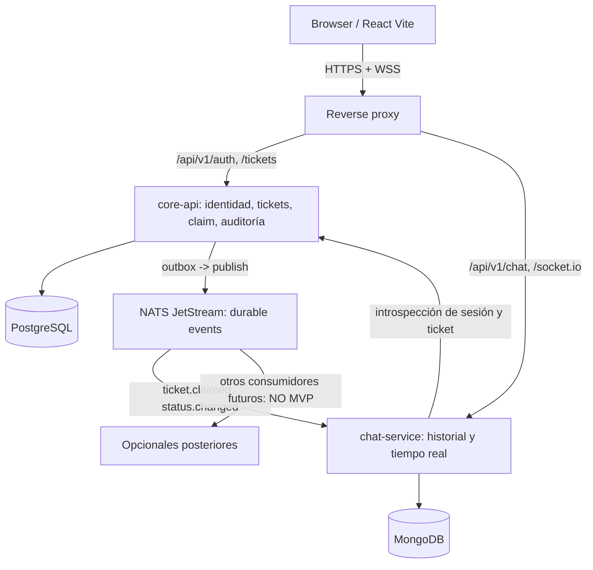

# 007 · EDA / microservicios — evaluación previa a la decisión

**Nueva preferencia expresada el 10-11-2026:** explorar EDA + microservicios para FixIt en vez de asumir un monolito. **No es todavía un acuerdo de arquitectura del equipo**. Ver [ADR-004](adr/ADR-004-eda-two-services.md). Scope IT Help Desk, chat por ticket, claim por agentes y bases compartidas de desarrollo permanecen vigentes.

## 1. Qué significa EDA aquí

- **Microservicios:** al menos dos despliegues con runtime independiente, interfaces claramente separadas y ownership de datos.
- **EDA:** publicar hechos ya confirmados como eventos; un consumidor los procesa sin acoplamiento temporal estricto al productor.
- **NO** significa que las acciones críticas se hagan "por eventos" sin garantías. El claim de ticket debe seguir siendo una operación **atómica en PostgreSQL** en el servicio propietario; un evento posterior informa a otros.
- Una EC2 física puede alojar varios servicios Docker. Eso muestra separación lógica, pero **no** alta disponibilidad ni aislamiento físico.

## 2. Comparación honesta

| Aspecto | Monolito modular (alternativa documentada en 003) | EDA de dos microservicios (candidato) |
| --- | --- | --- |
| Despliegue | Un backend Node | Dos runtimes Node + broker |
| Origen de verdad | API única | Core API dueño de tickets; Chat dueño de mensajes |
| Eventos | Internos al mismo proceso | Contratos persistentes y broker |
| Atomicidad del claim | Transacción PostgreSQL | **La misma** transacción en Core |
| Chat/roles | Un backend valida | Chat consulta autorización a Core por interfaz interna |
| Observabilidad | Una traza y logs | requestId/eventId/correlationId y diagnóstico entre servicios |
| Fallos | Un runtime | Broker o Chat pueden fallar aunque Core siga sano |
| Pruebas | Unitarias + integración + e2e | Lo anterior + contratos, duplicados, reintentos y outbox |
| Recursos/costo | Menor memoria y operaciones | Mayor memoria, arranque y mantenimiento |
| Beneficio académico | Web II y Cloud | Web II, Cloud **y** caso práctico de sistemas distribuidos |

**Conclusión provisional:** si el objetivo de arquitectura es **demostrar EDA real**, un servicio Core y uno Chat, unidos por NATS JetStream, ofrece una separación verificable sin partir artificialmente Auth/Tickets/Notifications en cinco servicios.

## 3. Candidato mínimo EDA

**Servicios y responsabilidades:**

- **core-api:** login/logout/sesiones, Reporter/Agent/Admin, CRUD de tickets, claim concurrente y transiciones, auditoría, catálogo. PostgreSQL **solo** es accesible al Core.
- **chat-service:** Socket.io, mensajes persistentes y recuperables, rooms, idempotencia de mensajes, proyección de eventos para notificaciones UI. MongoDB **solo** accesible al Chat.
- **NATS con JetStream:** transporte **interno** para eventos durables (no datos sensibles completos). Core no necesita conocer los consumidores. Core **no** delega el commit del ticket al broker.
- **reverse proxy y React SPA:** rutas públicas; no exponer bases/broker ni APIs internas a Internet.

### Autoridad y seguridad (no opcional)

La autorización de cada join y envío de chat se confirma consultando a Core (API interna autenticada con credenciales de servicio, además de identidad de usuario); los eventos en el broker **no** son fuente autoritativa de permisos. Ante caída de Core, Chat **no** acepta nuevas operaciones que no pueda autorizar. Reasignaciones revocan acceso y disparan prueba de sesiones Socket.io antiguas.

### Entrega y consistencia de eventos

1. En una **transacción PostgreSQL**, Core actualiza el ticket y añade `ticket_events` y `outbox_events`; termina commit.
2. Publicador dentro de Core toma outbox pendiente y publica en **JetStream**. Tras confirmación del broker marca publicado; si falla el proceso, se reintenta.
3. Chat consume con ACK, usa **inbox/deduplicación por eventId** y aplica solo si versión/orden del ticket lo permite. No prometer orden global ni exactly-once.
4. Eventos propuestos: `ticket.created.v1`, `ticket.claimed.v1`, `ticket.status-changed.v1`, `ticket.reassigned.v1`. Envoltorio: `eventId`, `type`, `schemaVersion`, `aggregateId`, `aggregateVersion`, `occurredAt`, `correlationId`, `payload` mínimo. No publicar email/contraseña/chat privado en eventos de ticket.
5. Si Chat está apagado, Core continúa creando/asignando tickets y JetStream guarda eventos según política de retención. Cuando vuelve Chat, reconsume; el estado debe reconciliarse con Core, no confiar ciegamente en cada evento antiguo.
6. S3 Versioning es **para artefactos de release**, no reemplaza JetStream ni la outbox.

**Garantía seleccionada como candidata:** *at-least-once + procesamiento idempotente*. Core NATS por sí solo no almacena mensajes para consumidores ausentes; JetStream sí aporta persistencia y redelivery. Fuente oficial: https://docs.nats.io/concepts/jetstream .

## 4. Gate de capacidad: t3.medium

**Candidata aprobada para evaluar** (no es AWS provisionada): 2 vCPU, **4 GiB** RAM. Ver ficha oficial: https://aws.amazon.com/ec2/instance-types/t3/ .

Antes de aceptar EDA real:

- Ejecutar localmente (limitando recursos a equivalente t3.medium) `web-static/proxy + core-api + chat-service + PostgreSQL + MongoDB + NATS JetStream`.
- Perfil de **arranque, reposo, 10 usuarios simultáneos, ráfagas de mensajes, publish-retry, contenedores reiniciando**; registrar RAM pico y CPU.
- **Meta provisional:** uso total estable claramente menor a 4 GiB y con margen de alrededor de 1 GiB para host/cache, sin OOM ni swap sostenida. Ajustar a datos medidos. Si no cabe, recortar extras/ajustar motor o broker y reabrir ADR-002/004; no incrementar tamaño AWS silenciosamente.
- Las instancias T3 tienen créditos CPU y en modo Unlimited pueden generar cargos adicionales; medir carga prolongada y confirmar ajustes/costos con Marvin.
- Cuentas nuevas AWS Free tienen límites y elegibilidad; no asumir que la t3.medium está cubierta sin comprobarlo en Billing.

## 5. Gates para elegir y empezar a implementar

| Gate | Qué aprobamos / verificamos | Evidencia mínima | Si no pasa |
| --- | --- | --- | --- |
| **G0 — alcance y rúbrica** | 3 roles, chat por ticket, claim; temas obligatorios de Félix y Marvin | FR/NFR revisados; requisitos Cloud/S3 confirmados | Reducir alcance y actualizar PRD |
| **G1 — arquitectura y ownership** | 2 servicios, interfaz auth, dueño de PG/Mongo, contrato eventos, ADR-004 | Diagrama + ADR + 3 ejemplos JSON, respuestas a fallos | Elegir variante menos distribuida |
| **G2 — spike de capacidad/costo** | Reproducir 6 procesos sobre recursos de t3.medium y presupuestar EC2 + EBS/IP/S3 | `docker stats`, RAM pico, CPU, borrador de calculadora AWS | Reducir servicios o reabrir hosting |
| **G3 — protocolo de consistencia** | claim atómico, outbox, reintentos/dedupe, permisos de Chat con Core caído | Pruebas de integración + contratos, duplicados y reconexión | No comenzar UI avanzada |
| **G4 — estructura y verificaciones** | Repo, CONTEXT, AGENTS, rutas tests y skill verify sólo si vale la pena | Scaffold reproducible y tests verdes en CI local | No crear más subservicios |
| **G5 — AWS y entrega** | IAM individual, SSM, HTTPS, S3 privado/versionado, budget y rollback | Evidencia en nube + coste observado + cleanup | Mantener demo local sin afirmar Cloud completado |

**Próxima decisión imprescindible:** ¿realmente requiere el profesor EDA/microservicios o es un objetivo de arquitectura del equipo? Si es interés académico personal, seleccionar un solo caso EDA bien probado es más defendible que multiplicar servicios para mostrar tecnología.

Fuente original del repositorio: [sección 17 del PDF compartido por Valeria](references/FixIt_Project_Specification.pdf), que plantea client/server y tests pero **no** especifica un broker, outbox ni microservicios. Lo anterior es diseño **nuevo**, no atribuido al PDF.
