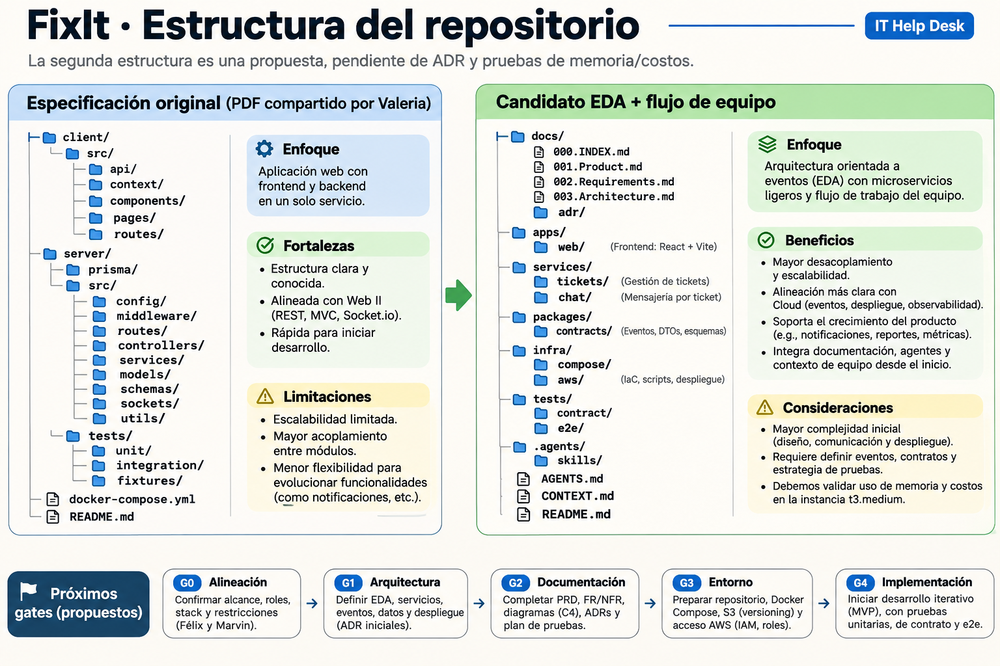

# 008 · Estructura de repositorio — de la base de Valeria a EDA

**Estado:** layout **ilustrativo**, NO directorios implementados salvo la documentación ya existente. Relacionado con [007.EDA-Evaluation](007.EDA-Evaluation.md). Mantener el nombre FixIt en el repo; no realizar scaffolding hasta superar G1/G2.

## 1. ¿Qué dice realmente el documento compartido por Valeria?

**Sección 17, página 18:** directorios `client/src/{api,context,components,pages,routes}`, `server/prisma`, `server/src/{config,middleware,routes,controllers,services,models,schemas,sockets,utils}`, `server/tests/{unit,integration,fixtures}`, `server/docs/openapi.yaml`, `server/Dockerfile`, `docker-compose.yml` y `README.md`. Es una estructura de una SPA React y un único backend Node/Express; no es EDA ni microservicios per se.

**Puntos fuertes:** responsabilidades web familiares, Prisma y Mongo visibles, frontend separado, tests cercanos al backend, validación, Socket.io, API spec y Compose. **No se deben perder** al pasar a EDA.

**Diferencias nuevas propuestas por el equipo:** scope IT-only, ownership por servicio, broker/eventos, pruebas de contratos, CONTEXT/AGENTS para colaboración asistida y distribución IAM/Cloud. No atribuir al PDF original.

## 2. Árbol propuesto para EDA de dos servicios

```text
FixIt/
├── README.md
├── CONTEXT.md                  # mapa compacto: estado, decisiones, riesgos
├── AGENTS.md                   # instrucciones para coding agents; no secretos
├── .agents/
│   └── skills/                 # SOLO skills específicas del repo cuando existan
│       └── fixit-verify/       # futuro: tests por interfaces y demo verificable
├── .github/
│   ├── workflows/              # futuro: lint, unit, integration/contract, e2e
│   └── PULL_REQUEST_TEMPLATE.md
├── apps/
│   └── web/                    # SPA React/Vite, basada en client/ del PDF
│       └── src/
│           ├── api/            # adaptadores HTTP/Socket.io
│           ├── components/
│           ├── pages/
│           ├── routes/
│           └── state/          # auth + estado de tickets/chats
├── services/
│   ├── core-api/               # dueño de PG (auth, tickets, assignments, audit)
│   │   ├── prisma/
│   │   ├── src/
│   │   │   ├── modules/        # auth, tickets, assignments, audit
│   │   │   ├── middleware/     # validar, autenticar, errores
│   │   │   ├── events/         # outbox, publisher, schema
│   │   │   └── app.ts
│   │   ├── tests/              # unit/, integration/, fixtures/
│   │   └── Dockerfile
│   └── chat-service/           # dueño de Mongo (messages, Socket.io)
│       ├── src/
│       │   ├── messages/
│       │   ├── sockets/
│       │   ├── subscribers/    # eventos recibidos del Core
│       │   └── auth/           # chequeo de permiso mediante Core
│       ├── tests/              # unit/, integration/, fixtures/
│       └── Dockerfile
├── packages/
│   └── contracts/              # eventos .v1, esquemas JSON/TS + tests de contrato
├── tests/
│   ├── contract/               # cross-service / schemas/eventos
│   └── e2e/                    # reporter -> claim -> chat -> close
├── infra/
│   ├── compose/                # base + overrides dev/test; NATS/PG/Mongo
│   ├── proxy/                  # Caddy/NGINX solo si se requiere
│   └── aws/                    # artefactos AWS/scripts; IaC solo si gate lo pide
├── docs/
│   ├── 000.INDEX.md ... 008.Repository-Structure.md
│   ├── adr/
│   ├── assets/
│   └── references/             # PDF original intacto
├── .env.example                # variables ficticias sin credenciales
├── .gitignore
└── compose.yaml                # entrypoint Compose local
```

**No crear todo el árbol de golpe.** Al superar G1 y G2: crear `apps/web`, `services/core-api`, `services/chat-service`, `packages/contracts`, `infra/compose`, `tests/contract` y `tests/e2e`. `.agents/skills/fixit-verify` se crea **solo cuando haya un flujo real que automatizar**; no copiar las skills globales del usuario ni introducir instrucciones redundantes. Los directorios `.github/workflows` y `infra/aws` aparecen cuando haya pruebas/despliegue reproducibles.

## 3. Cómo encajan CONTEXT.md y AGENTS.md

- **CONTEXT.md:** una página al día del estado/decisiones; remite a `docs/000.INDEX.md` en vez de duplicar requisitos. Cambia con hitos, no con cada edición menor.
- **AGENTS.md:** instrucciones de ingeniería aplicables a contribuciones por agentes (cam-route, permisos, checks, prohibir auto-commit/push, manejar secretos y alcance).
- **.agents/skills/:** exclusivamente verificaciones/acciones del repo que se ejecuten de verdad. No prometer que una carpeta vacía da más capacidades.
- **Tests:** en cada servicio para unidad/integración; en raíz para contrato entre servicios y E2E. No repetir la misma prueba en cuatro lugares.
- **OpenAPI:** en `services/core-api/docs/openapi.yaml` y, si existe HTTP en Chat, su contrato separado; `packages/contracts` es únicamente para eventos **entre servicios**, no toda la lógica de negocio.

## 4. Imagen de referencia



*Imagen conceptual creada para comparar las estructuras; muestra la versión resumida de ambos árboles. El árbol textual anterior es la fuente de verdad para los nombres completos de carpetas.*

## 5. Costos de complejidad adicionales a estimar

- 2 Dockerfiles, 2 procesos Node, 2 pipelines de test y deployment, un NATS con volumen y outbox.
- Contratos con versión y deduplicación, autorización entre servicios, health de cada proceso, correlación de logs, recovery/retención JetStream.
- Coherencia entre PRs y repositorio; si el equipo no puede implementar y probar el camino de un ticket entre servicios, **no debemos ampliar a más microservicios**.

## 6. Próximos gates

Primero [G1 de arquitectura](007.EDA-Evaluation.md) para decidir ownership y contrato, luego [G2 de capacidad](007.EDA-Evaluation.md), después G3 de consistencia y pruebas. **Crear carpetas sin aprobar estas decisiones daría apariencia de avance, no una base funcional.**

Fuentes: PDF original compartido, pp. 16–19, especialmente sección 17; [README](../README.md); [ADR-004](adr/ADR-004-eda-two-services.md).
