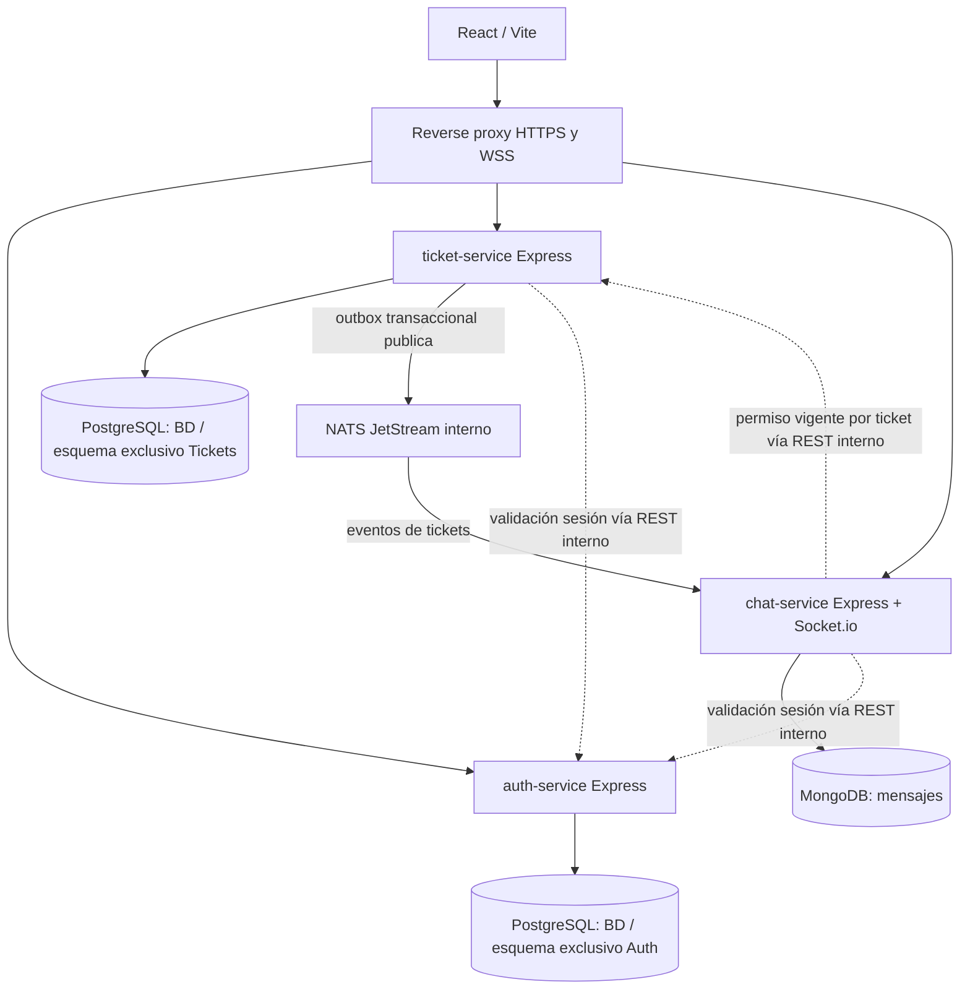

# 009 · HANDOFF — Continuidad para el próximo chat

**Leer este archivo primero para retomar FixIt.** Es un resumen fiel de los acuerdos conversados **hasta el 10 de noviembre de 2026** y de lo que todavía se debe decidir. No es un ADR aprobado, ni prueba de infraestructura desplegada ni reemplazo de [000.INDEX.md](000.INDEX.md).

## 0. Estado operativo real

- Repo privado: `https://github.com/caml07/FixIt`. Rama de trabajo: `dev`; `main` se había dejado sin implementación. El último estado antes de este handoff: documentación y diagramas, **sin código del producto ni AWS desplegado**.
- Se habían publicado docs canónicos `001`–`008` y cuatro ADR en `dev` (commit de documentación anterior: `d87bab7`). **Los cambios de este handoff están locales hasta que se autorice commit/push**.
- Equipo: **caml07, Valeria (`avaleria13`), Rina (`Rinahrrg`)**. Los tres contribuyen a Web Dev II. **Rina no cursó Cloud**; caml07 y Valeria sí.
- El equipo dio visto bueno a **FixIt IT Help Desk** como alcance principal. La propuesta original de mantenimiento general se conserva sin modificar.
- En este chat el usuario **eligió explorar tres microservicios** (**Auth, Tickets y Chat**) conectados por NATS, y **eligió sesiones opacas + bcrypt** sobre JWT para profundizar G1. **Elección de diseño para continuar la discusión, no ratificación formal del equipo ni funcionamiento implementado.**
- **No crear código, estructuras vacías, recursos AWS o nuevos commits por inercia.** Primero cerrar decisiones y pruebas de viabilidad. Conservar commits/push bajo petición explícita.

## 1. Fuentes disponibles y qué significa cada una

| Fuente | Función | Precaución |
| --- | --- | --- |
| [PDF original FixIt](references/FixIt_Project_Specification.pdf) | Propuesta amplia con mantenimiento de edificios, IA, roles, REST y testing | Referencia **histórica**; NO especificación aprobada del MVP |
| [PDF adicional de adaptación a Cloud y SE II](references/FixIt_Adapting_Cloud_and_Software_Engineering_II_2026-11-10.pdf) | Propuesta compartida por Valeria, **23 páginas**: un proyecto para **tres materias**, DDD y variante AWS con dos VPC/VM | Diseño alternativo; atribuirlo como **compartido por Valeria**, no dar por aprobados autoría, fechas, scope ni requisitos docentes |
| [001.Product](001.Product.md) + [002.Requirements](002.Requirements.md) | Alcance IT Help Desk, FR/NFR y criterios de aceptación | Fuente canónica del **producto**; algunos ejemplos requieren ajuste tras cerrar G1 |
| [003.Architecture](003.Architecture.md) + [ADR-001](adr/ADR-001-scope-and-modular-monolith.md) | **Alternativa anterior** de monolito modular | NO usar como arquitectura elegida |
| [007.EDA-Evaluation](007.EDA-Evaluation.md), [008.Repository-Structure](008.Repository-Structure.md), [ADR-004](adr/ADR-004-eda-two-services.md) | **Candidato anterior**: Core API + Chat + NATS, con diagramas y tests | Desactualizados frente a la exploración actual de **tres** servicios; modificar solo tras cerrar G1 |
| [004.Cloud](004.Cloud.md), [005.Delivery](005.Delivery.md), [006.Decisions](006.Decisions.md) | Costos, entregas y registro histórico de decisiones | AWS y fechas **aún sujetos a confirmación** |

**Hallazgo del PDF adicional (págs. 1–3, 9–23):** propone que Web Dev II implemente la app, Cloud la despliegue y **Software Engineering II** modele el dominio mediante **DDD**, además de un cronograma. **No es evidencia de que los profesores hayan aprobado reutilizar FixIt en los tres cursos.** El PDF propone volver a *facility maintenance*, triage/IA, hazard, dispatch, SLA y `WorkOrder`, frente a nuestro **IT Help Desk reducido**, sin IA, sin riesgos físicos, sin dispatch automático ni SLA como MVP. No mezclar estos modelos sin decisión humana.

**Cloud:** el usuario explicó que Marvin presentó una propuesta de actividades, **no un mandato de reproducir exactamente dos VPC/peering/dos VM**. Se espera demostrar lo aprendido (VPC, seguridad, despliegue, S3, costos, monitoreo). Confirmar evidencias y rúbrica con Marvin. **Web II:** Félix dejó proyecto libre, según el usuario.

**Software Engineering II:** el PDF adicional afirma propuesta de dominio con aprobación docente, lenguajes preferidos Java/Python y necesidad de dos `bounded contexts` implementados (págs. 2, 11, 18–19). Son **afirmaciones del documento**, no rúbrica primaria verificada: preguntar al profesor si puede hacerse en **TypeScript** y enfocarse en **IT Help Desk**. Si no, separar entregable académico acotado, sin contaminar el producto.

## 2. Producto: lo que no cambiamos al explorar arquitectura

**Personas:** Reporter (abre ticket IT), Support Agent (toma ticket disponible y responde), Admin (observa/reasigna/gestiona).

**Recorrido MVP:** login → crear ticket IT (Wi-Fi, software, hardware, cuentas, periféricos) → un agente lo toma → conversación persistente dentro del ticket → `IN_PROGRESS` → `RESOLVED` → confirmación `CLOSED`; `CANCELLED` solo desde `OPEN` (según reglas propuestas).

**Invariantes importantes:**
- Autoasignación **atómica** en base relacional: solo si `status=OPEN` y `assigneeId IS NULL`; dos agentes concurrentes ⇒ **uno gana y otro recibe 409**. Guardar ticket+auditoría+outbox en misma transacción.
- Chat solo para reporter correspondiente, agente actual asignado y admin, comprobando ownership en **backend y Socket.io**. El agente anterior pierde acceso tras reasignación.
- Mensajes se guardan antes de ACK/broadcast; reintentos idempotentes; estados terminales bloquean escritura.
- Fuera del MVP: IA/triage automático, peligros físicos, inventario, SLA automáticos, microservicios adicionales sin necesidad, múltiples organizaciones.

## 3. G1 — arquitectura candidata ACTUAL (tres microservicios)

**No compartir tablas entre Auth y Tickets.** Pueden compartir *instancia física de PostgreSQL* por presupuesto, pero distintas BD/esquemas, credenciales, migraciones y ownership. Mongo pertenece al servicio Chat. React nunca accede directamente a DB ni NATS.

| Servicio | Es dueño de | No debería poseer |
| --- | --- | --- |
| **Auth** | Identidades, contraseñas bcrypt, sesiones opacas, estado de cuenta y roles globales; login/logout y una interfaz interna para introspección | Datos completos de tickets o mensajes |
| **Tickets** | Tickets, categorias IT, asignación concurrente, estados, auditoría y outbox; decide *ownership y permisos del ticket* | Hashes de contraseñas y contenido de mensajes |
| **Chat** | Mensajes, histórico, Socket.io, idempotencia, salas, consumo de eventos; verifica autorización consultando Tickets | Control de estados, roles globales o DB de Tickets |
| **NATS JetStream** | Transporte durable de eventos de dominio y redelivery | Decisiones autoritativas sobre tickets o sesiones |

**Autenticación elegida para diseñar:** `bcrypt` con salt propio gestionado por la librería; `cost=12` es **hipótesis de benchmark**, no ajuste final. OWASP hoy prefiere Argon2id para sistemas nuevos; bcrypt es una elección consciente por el módulo Web II y requiere tratar su límite de **72 bytes**, rate limiting y hash sin secretos expuestos. **Sesiones opacas** aleatorias de alta entropía con **token hasheado en servidor**, revocación y expiración; browser recibe cookie `HttpOnly; Secure; SameSite` apropiado. **Auth valida; Ticket aplica RBAC y ownership del ticket; Chat aplica la decisión de ticket**. Proteger CSRF en operaciones mutadoras con cookies. Usar una forma de autenticación **servicio-a-servicio** separada de la cookie y no hacer pública la introspección. Aún faltan contratos exactos, cache/latencia y control de fallos.

**Contratos REST propuestos, NO especificación OpenAPI cerrada:**
- Auth: `POST /auth/login`, `POST /auth/logout`, `GET /auth/me`; interno `POST /internal/sessions/introspect` (solo servicios autenticados).
- Tickets: `POST /tickets`, `GET /tickets`, `POST /tickets/:id/claim`, `PATCH /tickets/:id/status`; interno `POST /internal/tickets/:id/authorize` (actor + acción, servicio autenticado).
- Chat: `GET /tickets/:id/messages`, `chat:send` y `ticket:join` por Socket.io; ruta HTTP POST para mensajes pendiente de necesidad real.

**Eventos iniciales propuestos:** `ticket.created.v1`, `ticket.claimed.v1`, `ticket.status-changed.v1`, `ticket.reassigned.v1`. Envoltorio mínimo: `eventId`, `type`, `aggregateId`, `aggregateVersion`, `occurredAt`, `correlationId`, `payload` no sensible. `Transactional outbox` dentro de Ticket PostgreSQL, broker NATS JetStream entrega *at least once*, consumidores idempotentes por `eventId`; **no afirmar exactly-once**, orden global ni atomicidad SQL↔Mongo.

**Fallas planificadas:**
- Chat caído: Tickets continúa operando, sin chat.
- Broker caído: Ticket guarda outbox y reintenta publicación; no bloquea commit del ticket.
- Mongo caído: no ACK positivo de mensajes.
- Auth caído: sesiones no se pueden introspectar; **fail-closed** para nuevas acciones que requieran identidad.
- Ticket caído: Chat no puede autorizar nuevas acciones; **fail-closed**; requerir refetch tras reconexión.
- EC2 detenida: caen todos los contenedores, persisten datos en volúmenes correctamente configurados.

**Consejo DDD derivado del PDF de Valeria:** no equiparar automáticamente **3 microservicios = 3 bounded contexts de negocio**. Identity es genérico, Chat es soporte, Tickets contiene la lógica de dominio. Si SE II exige **2 bounded contexts de negocio**, explorar `Issue Intake` y `Support Resolution` **dentro de Tickets** como contextos conceptuales (NO como nuevos microservicios automáticamente). La propuesta original usa `Intake` y `Maintenance` para facility maintenance: no renombrar nuestro dominio para hacer que coincida sin confirmación docente.

## 4. G0–G5 para el siguiente chat

| Gate | Estado al cierre de este chat | Evidencia que falta / decisión siguiente |
| --- | --- | --- |
| **G0 — academia y scope** | **Producto IT Help Desk acordado; tres materias aún no confirmadas** | SE II: dominio IT Help Desk aprobado, TypeScript permitido, dos bounded contexts exigidos o no; Cloud: requisitos finales y fechas; Félix: libertad del proyecto ya informada |
| **G1 — arquitectura + contratos** | **En progreso**: usuario opta por explorar 3 servicios y elige sesiones opacas+bcrypt | Aprobar límites de Auth/Tickets/Chat, esquema de sesión, REST interno protegido, contratos de eventos `v1`, autorización cross-service, gestión de errores; **crear ADR de 3 servicios (nuevo, no reescribir ADR-004 de 2 servicios como aprobado)** |
| **G2 — capacidad/costo** | **No verificado**: t3.medium elegida como candidata | Benchmark local equivalente a **2 vCPU/4 GiB** con **3 Node + PostgreSQL + MongoDB + NATS + proxy**, medido bajo carga; EC2/volumen/IP/S3/logs, elegibilidad AWS Free y CPU credits con Marvin |
| **G3 — consistencia/seguridad** | **Diseño propuesto, sin código** | Test concurrencia claim + evento/commit/outbox; eventos duplicados/reintentos; permisos Socket tras reasignación; login/logout/CSRF/sesiones caducadas; restarts y fallos de DB/broker |
| **G4 — repo y pruebas** | **Árbol visual propuesto, no creado** | Adaptar `apps/web`, `services/{auth-service,ticket-service,chat-service}`, `packages/contracts`, `infra`, `tests/{contract,e2e}`, `CONTEXT.md`, `AGENTS.md`, `.agents/skills` sólo si son útiles; PR hacia `dev` |
| **G5 — Cloud y entrega** | **Nada desplegado** | VPC/SG/IAM MFA, acceso Rina acotado a DB, SSM, TLS, S3 Versioning (Git sigue fuente de código), monitoreo, backup/restore, costos y cleanup; decidir EC2 única vs. app+DB separadas |

**Prioridad real:** terminar G0 respecto a SE II y **cerrar G1** antes de generar scaffolding. G2 (capacidad) puede ocurrir mediante spike mínimo tras G1 sin implementarlo todo.

### Fechas mencionadas en el PDF adicional — SIN VERIFICACIÓN DOCENTE

- Cloud informe de progreso: **24 nov**; informe Word + slides + video: **1 dic**; defensa: **3 dic**.
- SE II ZIP con UML/report: **29 nov**.
- Web II presentación: **7 dic**, que ya figuraba en la propuesta original.
- Hay tensión entre apagar AWS después de Cloud y presentar Web II después; acordar demo local o ventana de EC2 y costo.
- Rina no está obligada académicamente por Cloud según información actual. Distribución de tareas todavía no asignada.

## 5. Inconsistencias conocidas en docs previos: NO HEREDARLAS COMO ACUERDOS

1. `001.Product.md` menciona microservicios entre "fuera de alcance": **ahora se están evaluando explícitamente**. El alcance funcional sigue siendo IT Help Desk.
2. `000.INDEX.md`, `006.Decisions.md`, `007.EDA-Evaluation.md`, `008.Repository-Structure.md`, `ADR-004` describen **dos** servicios Core/Chat: **propuesta histórica anterior**, no elección actual.
3. `003.Architecture.md` presenta el monolito como alternativa anterior, no objetivo elegido.
4. `006.Decisions.md` tenía `A-05` como "Open" (JWT vs sesiones): **la preferencia del usuario se resolvió a sesiones opacas**, queda pendiente formalizar protocolos y aceptación por equipo.
5. La propuesta adicional trae `WorkOrder`, `DISPATCHED`, SLA, AI y hazards. **No cambiar Ticket/ASSIGNED/IT scope** sin acuerdo explícito.
6. `004.Cloud.md` calcula costos de una sola EC2 como alternativa; no es cálculo para 3 microservicios + 2 VPC. No prometer AWS sin saldo verificado.
7. PDF adicional propone landing S3 pública/HTTP/SSH jump host. **No adoptar configuraciones de exposición tal cual**: revisar HTTPS, SSM, permisos mínimos, riesgos de públicos y alternativas con costo.

## 6. Primer paso sugerido en el próximo chat

**Mensaje para copiar/continuar:**

> Retomemos FixIt desde `docs/009.HANDOFF.md` y `docs/000.INDEX.md` en `/home/caml/Projects/FixIt` (rama `dev`). Revisa también el PDF nuevo en `docs/references/FixIt_Adapting_Cloud_and_Software_Engineering_II_2026-11-10.pdf`. Seguimos en **G1**, con **3 microservicios candidatos (Auth/Tickets/Chat), NATS JetStream, bcrypt y sesiones opacas**. Primero definamos los contratos REST internos, permisos y eventos, y resolvamos el punto de DDD para Software Engineering II. Las referencias de 2 microservicios son históricas. No implementes ni hagas commits/push hasta que lo solicite.

**Comando de revisión para el siguiente agente:** `git status --short --branch` y después leer `docs/009.HANDOFF.md`, `docs/000.INDEX.md`, `docs/006.Decisions.md`, `docs/002.Requirements.md`. No debe necesitar reconstruir esta conversación.
