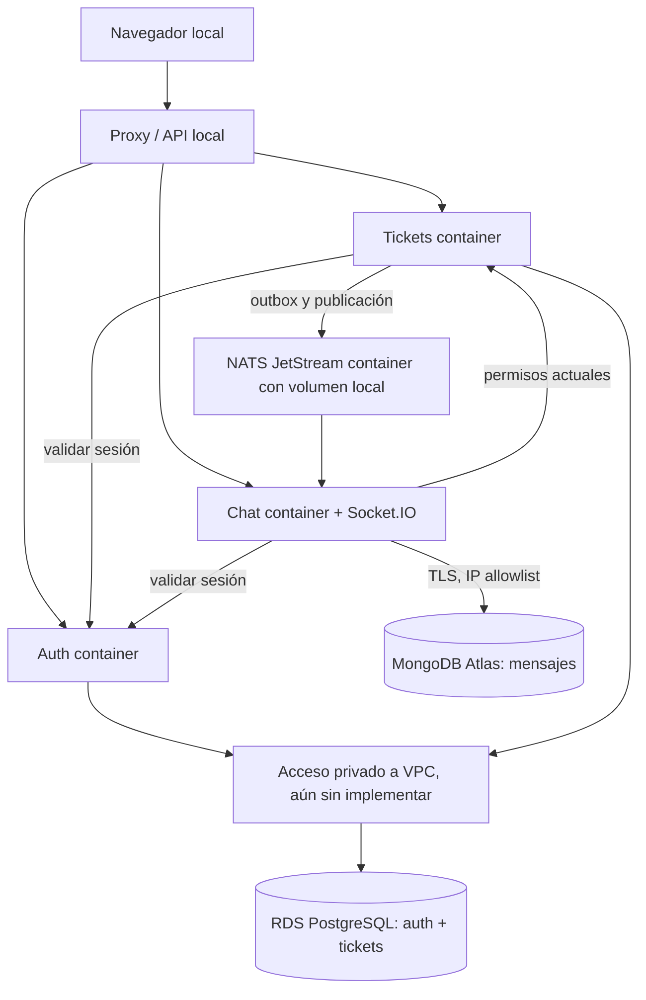

# 015 · Desarrollo híbrido: contenedores locales, bases remotas

**Decisión de etapa (18 nov, usuario):** empezar desarrollo de Auth, Tickets y Chat como procesos/contendores **locales**, con las bases de datos **en la nube cuando el acceso y el presupuesto estén autorizados**. Esta etapa es anterior a decidir entre EC2/Compose y ECS Fargate para los servicios. **NO existe evidencia de que RDS, Atlas, VPN, túneles ni servicios estén provisionados.** La alternativa local completa sigue disponible para trabajar offline, ejecutar CI y reducir costos.

## Topología de la etapa

**No colocar NATS en S3:** JetStream necesita su propio almacenamiento activo duradero. S3 continúa reservado para **versiones de releases** y, cuando sea viable, backups privados probados. No colocar fotos/videos en PostgreSQL o Mongo como blobs; metadatos y referencias autorizadas, proveedor de objetos por decidir.

## Qué corre en cada lugar

| Componente | Inicio de desarrollo | Después, si se acepta Cloud |
| --- | --- | --- |
| React, reverse proxy, Auth, Tickets, Chat | Local; contenedores independientes; puertos internos no publicados indiscriminadamente | ECS Fargate o EC2, por comparar |
| NATS JetStream | Local, con almacenamiento persistente propio y pruebas de reinicio | Broker duradero y recuperación diseñados aparte |
| PostgreSQL 17 | **RDS candidato**, acceso remoto seguro pendiente de habilitar; fallback PostgreSQL local | RDS privado, con la misma estructura de esquemas `auth` y `tickets` |
| MongoDB | **Atlas candidato** mediante URI `mongodb+srv://` y TLS, con base de prueba | Atlas con conectividad y política de backups verificadas |
| S3 | **No es requisito para programar o probar**. Sin recursos creados | Versioning privado para releases, backups tras validación |

### Bloqueo real: acceso remoto a RDS privada

RDS **sin acceso público** está dentro de la VPC: una API local no llega a ella simplemente copiando el hostname. La ruta preferida es un **acceso temporal y autenticado a la VPC**, por ejemplo port forwarding con AWS Systems Manager mediante una instancia administrada, o una VPN existente permitida. Esto exige **recurso de conexión, IAM, reglas de seguridad y costo comprobado**; por tanto **no es honesto prometer "solo pagamos RDS"**. El host de acceso es una ayuda operativa, no un cuarto microservicio. No abrir automáticamente PostgreSQL al público para evitar configurar la red.

Una **RDS pública con regla IP `/32` y TLS** sería otra topología técnicamente posible, pero **contradice la política actual NFR-002**, que prohíbe exponer motores DB a Internet. **No adoptarla ni provisionarla** sin una excepción explícita, evaluación de riesgo y autorización del equipo. La IP de salida de una universidad/casa puede cambiar y algunas redes bloquean 5432. Para un túnel, `localhost` visto desde el contenedor no es el host físico: configurar explícitamente el gateway del host y verificar **TLS con el hostname real del certificado**, sin desactivar `verify-full` por comodidad. Compatibilidad concreta de Prisma/Node con este túnel: **no probada**.

Atlas acepta conexiones TLS desde **IPs en la allowlist del proyecto** y con usuario propio de base de datos. Dar entrada temporal y limitada a la IP pública efectiva de cada integrante, nunca `0.0.0.0/0` por defecto. El tier gratuito/limitaciones y el acceso desde la universidad requieren comprobación. No guardar URI/password en Git, capturas, tickets ni logs.

**Fuentes oficiales (consultadas 18 nov):** [AWS RDS public/private](https://docs.aws.amazon.com/AmazonRDS/latest/gettingstartedguide/security-public-private.html), [RDS PostgreSQL TLS verify-full](https://docs.aws.amazon.com/AmazonRDS/latest/UserGuide/PostgreSQL.Concepts.General.SSL.html), [Atlas conexión](https://www.mongodb.com/docs/atlas/connect-to-database-deployment/), [Atlas acceso IP](https://www.mongodb.com/docs/atlas/security/ip-access-list/).

## Dos perfiles reproducibles

- **`local` (obligatorio):** Compose/Podman ejecuta Auth, Tickets, Chat, proxy, JetStream, PostgreSQL 17 y MongoDB locales, con datos ficticios. La CI usa exclusivamente bases efímeras; la caída de Internet no bloquea desarrollo.
- **`hybrid` (opcional después de autorizar Cloud):** mismos servicios locales, **sin contenedores PG/Mongo**, y credenciales remotas inyectadas por variables. `DATABASE_URL` y `MONGODB_URI` son variables de proceso, no archivos en Git; no presumir que ambos miembros disponen de acceso. Usar pools modestos, timeout y fallback seguro; nunca cambiar de base silenciosamente.

El Compose real todavía no existe en `dev`. **No inventar comandos `compose up` como si funcionaran ya.** Cuando los servicios se creen en una rama de integración, proveer `.env.example` **sin credenciales** y perfiles definidos. Campos sugeridos (sin valores reales): `DATABASE_URL`, `MONGODB_URI`, `NATS_URL`, `AUTH_INTERNAL_URL`, `TICKETS_INTERNAL_URL`, `PORT` y ruta de CA TLS si corresponde. Separar usuarios SQL `auth_runtime` y `tickets_runtime`, propietario de migración y usuarios Atlas con acceso mínimo. No usar credenciales de superusuario en las apps.

## Reglas para todos

1. **Sin AWS ni Atlas desde CI:** GitHub Actions trabaja con PostgreSQL/Mongo/NATS descartables; jamás migrar RDS real en un pull request.
2. **Sin datos reales de Keiser:** usuarios, capturas, videos y tickets de demostración ficticios. Backup/restore y pruebas BOLA se hacen sobre fixtures artificiales.
3. **Migrations:** un solo owner y secuencia coordinada; migración SQL validada localmente antes de aplicarla remotamente; no usar `prisma db push` contra RDS compartida. Plan de restore antes de migración destructiva.
4. **Secretos:** archivos `.env` ignorados, MFA individual, credenciales por integrante/servicio, rotación ante exposición. No poner variables reales en fallos de CI ni pasos de screenshots.
5. **Operación/costo:** antes de provisionar, verificar elegibilidad AWS Free/Paid, precios brutos, créditos, Atlas por separado, alarms, acceso seguro, retención y responsable de apagar/borrar recursos autorizados. Límite de planificación **US$120 acumulados de uso AWS con créditos comprobados**, no mensual ni presupuesto de Atlas.
6. **Independencia:** la selección posterior de Fargate/EC2 cambia despliegue y redes, no reglas de dominio ni contratos. No conectar navegador directamente a RDS/Atlas: siempre por backend autorizado.

## Preflight sin provisionamiento

- [ ] Valeria y usuario verifican con Marvin requisitos de Cloud y qué servicio gestionado es aceptable.
- [ ] Existe costo total de RDS + storage/backups + acceso privado/bastion/VPN, comparado con escenario local y alternativa sin RDS durante primeras semanas.
- [ ] Se verifican plan/saldo AWS y plan/cuota Atlas con permiso explícito para crear cada recurso.
- [ ] Se demuestra conexión privada PostgreSQL y TLS verificado; Atlas con allowlist mínima; cero motores públicos no autorizados.
- [ ] Se prueban smoke tests/migraciones en una **BD desechable** y persistencia/restore, antes de pasar al entorno compartido.

**Estado al escribir:** documentación de diseño únicamente; ninguna cuenta, instancia, servicio, bucket o conexión remota fue creada o validada aquí.
