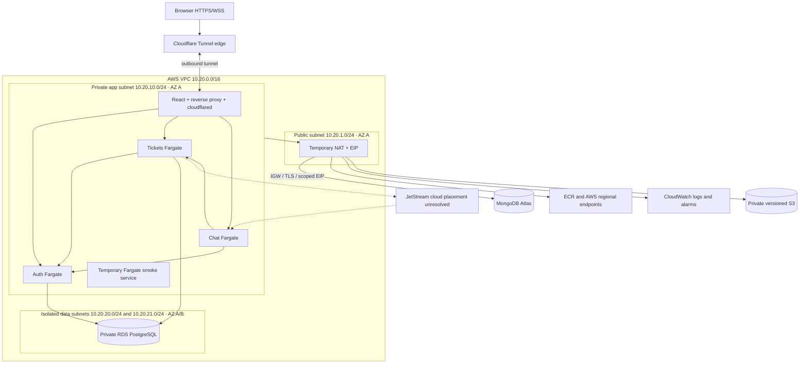

# FixIt — Cloud & Internet Computing | Progress Report No. 1

Keiser University, Latin American Campus · CEN4086 · Fall 2026
Instructor: Dr. Marvin Arias | Progress report (A–D)

**Status as of November 26:** The user selected ECS Fargate without EC2, temporary NAT, native CloudFormation and staged provisioning on November 23. Foundation was deployed in us-east-1 (23/23 resources CREATE_COMPLETE), including private S3 versioning. The user reports that Dr. Marvin Arias permits adaptations provided they are clearly contrasted with the original assignment. This is reported oral authorization to adapt, not written approval of each evidence item or a passing grade. The static S3 website remains a required final-project deliverable. IAM users were created on November 26, and Valeria's console access was enabled with mandatory password reset. See the [IAM access record](../infra/cloudformation/IAM-LAB-2026-11-26.md) and [foundation deployment record](../infra/cloudformation/DEPLOYMENT-2026-11-23.md). The smoke runtime, NAT, RDS, cloud broker durability, annual estimate, and integrated application deployment remain pending. Deadline: Friday November 27 at 11:59 PM CST per the [Blackboard assignment](https://keiseruniversity.blackboard.com/ultra/courses/_646801_1/assessment/_44237175_1/overview?courseId=_646801_1).

## A. Description of the proposed project

FixIt is an IT Help Desk for a controlled university pilot. It allows authorized users to submit IT incidents, support staff to manage tickets and participants to communicate in a ticket-specific chat. The application is designed around Auth, Tickets, Chat and a React frontend, with PostgreSQL for transactional data and MongoDB for chat messages. NATS JetStream is part of the existing local architecture.

The Cloud objective is to demonstrate infrastructure provisioning, virtual networking, managed compute, secure storage, monitoring, cost estimation and recoverability without maintaining EC2 servers. The academic infrastructure demonstration can run independently from unfinished application modules. This is not a second product and is not a claim that the integrated application is already deployed.

### Target architecture (not deployed)

The dotted broker represents an unresolved runtime dependency, not a hosted service. The smoke service is an independent temporary diagnostic workload, not the final application. AWS regional services and Atlas are outside the VPC. The CloudFormation templates currently implement foundation and smoke only, not the full target diagram.

| Network | CIDR | Route |
| --- | --- | --- |
| VPC | 10.20.0.0/16 | local |
| Public subnet | 10.20.1.0/24 | 0.0.0.0/0 -> IGW |
| Private app subnet | 10.20.10.0/24 | NAT default route only during approved session |
| Isolated data subnet A | 10.20.20.0/24 | local only |
| Isolated data subnet B | 10.20.21.0/24 | local only |

Use two AZs for the future RDS subnet group, not Multi-AZ RDS. Verify CIDR overlap, actual AZ availability and region before deployment. Fargate tasks have no public IP; the smoke security group allows outbound HTTPS only and no inbound access. Future application-specific security groups and IAM roles are not yet implemented. RDS must remain private and allow 5432 only from authorized application roles' SGs. Atlas uses TLS and an explicit NAT EIP allowlist, never 0.0.0.0/0; confirm compatibility with NFR-002 before real use. A new NAT EIP requires an updated Atlas allowlist. Keep local databases for development until a secure remote access path exists; no EC2/SSM jump host or public RDS shortcut.

### Simplification and durable messaging

The user explicitly rejected EC2. Do not use EFS/NFS as a presumed safe JetStream disk, or claim service-managed ECS EBS survives replacement. AWS states that volumes attached to service-managed tasks are deleted upon termination. Standalone Fargate tasks can retain EBS, but reattachment/recovery needs a separate design; it is not transparent service persistence. A managed NATS provider may avoid server maintenance but introduces external cost and connectivity. The application contracts currently rely on durable events, outbox retries and recovery; neither an ephemeral broker nor replacing NATS with another queue is approved. Keep JetStream in local Compose, defer the Cloud broker choice until recovery semantics and budget are validated. The AWS smoke exercise deliberately does not depend on the broker.

### Academic equivalence and evidence

Sources: [original Group Project Assignment, Week 9](https://keiseruniversity.blackboard.com/ultra/courses/_646801_1/document/_44237160_1?view=content&state=view), read November 23, and the [shared Progress Report 1](https://docs.google.com/document/d/1rFvcwBvDioH7gy1uRLTwy60P4tvhzeouR7ecGRzpRhE/edit), annotated and verified November 26. The user reported the instructor's permission to modify the work if the differences are well contrasted with the original. Preserve the original rubric and identify removed requirements, replacements, retained learning objectives, and actual evidence. Do not claim literal equivalence or instructor approval of every specific substitution.

| Original step | Adaptation and learning objective | Evidence and status |
| --- | --- | --- |
| A1 Root MFA and screenshot | Retain root MFA; add named IAM users with least privilege and individual MFA. | Root MFA previously verified by CLI; shared report contains an existing image. Three IAM users created; Valeria's console access enabled. Verify her MFA and actual sign-in. |
| A2 S3 static index.html | Retain customized website based on Challenge Project 8-1, author identification and learning/project text. Add a separate private versioned release bucket; versioning does not replace hosting. | Valeria can create her assigned website bucket; website endpoint and screenshot in a separate tab are pending. Private release bucket versioning/block public access verified; sample versions pending. |
| A3 Two VPCs, non-overlapping CIDRs and peering screenshot | Remove second VPC and peering. Use one VPC with four non-overlapping public, private app and isolated data subnets. Preserve segmentation and explicit routing objectives. | Capture VPC/CIDRs, subnet associations, route tables, IGW and temporary NAT during the session. Foundation routes deployed; NAT pending. No peering demonstration. |
| A4 VM in each VPC and network diagram | Remove both EC2 VMs and public VM. Use private Fargate tasks without public IP and controlled NAT egress; plan private RDS in isolated data subnets. Preserve compute provisioning, isolation and network diagram requirements. | Capture task definition (CPU/memory), ECS service, RUNNING task, ENI, subnet and security group. Diagram must include CIDRs, gateways, connections and security groups, distinguish deployed vs planned resources. Templates and diagram exist; runtime/RDS pending. |
| A5 ICMP between VMs and internet ping from each | Remove literal ICMP/pings. Demonstrate allowed outbound connectivity and network isolation with image pull, CloudWatch startup logs and private task ENI; inspect isolated routes without a default route. Add an explicit HTTPS request from a task and later authorized/denied TCP to RDS. | Capture actual results/logs and route tables. Route inspection is not an active denied-egress test or proof of RDS isolation; do not claim either. Smoke and additional active tests pending. |
| A6 VM alarm | Replace with CloudWatch ECS CPUUtilization alarm, preserving compute monitoring. | Capture AWS/ECS namespace, ClusterName and ServiceName, average CPU >80%, five 60-second periods. ALARM state or SNS notification not required. Template exists; alarm deployment pending. |
| A7 One-year estimate | Retain annual AWS Pricing Calculator scenario; distinguish hypothetical annual cost and real session spend under US$120 credit-eligible ceiling. | Calculator screenshot/export and session budget pending. |
| A8 Documentation | Retain diagram, screenshots and saved configurations; add templates, validation outputs and runbook in repo. | Partial; collect evidence of actual deployments. |
| A9 Presentation | Retain group practice and demonstration. | Pending. |
| A10 Cleanup | Retain final cleanup and sign-out. Tear down temporary runtime after each session; remove foundation and retained buckets/repositories after evidence export at project end. | Pending; check residual costs and inventory. |
| B Source code | Retain project code; include CloudFormation templates and runbook. | Templates exist; integrated app release pending. |
| C Literature survey | Retain original requirement. | Draft below. |
| D Improvement | Native CloudFormation, staged provisioning, private S3 versioning, immutable ECR tags and CloudWatch. | Foundation deployed; runtime/monitoring pending. |

The website must be separate from the private release bucket and contain no login, sessions, institutional data or secrets. Use the native S3 website endpoint for academic evidence only; it uses HTTP. Do not change account-wide public access settings. See the IAM access record for the assigned bucket names.

The current smoke template starts a container and writes a startup message. It does not yet issue an explicit HTTPS request or run an active isolation test. If required for A5, extend the diagnostic workload and obtain deployment authorization before running it.

## B. Source code and infrastructure automation

The repository contains application contracts and local prototypes; integrated application release is pending. Two actual CloudFormation templates have been written:

- [foundation.json](../infra/cloudformation/foundation.json): VPC, four subnets, three route tables, IGW, outbound-only smoke SG, ECS cluster, four immutable ECR repositories and private encrypted/versioned S3 bucket. No NAT, IP allocation, DB, compute task or alarm.
- [session-smoke.json](../infra/cloudformation/session-smoke.json): temporary zonal NAT/EIP, private default route, minimal log execution role, Fargate task definition/service (default desired count 0), 7-day log group and CPU alarm. This stack incurs NAT/IP/monitoring costs even with zero tasks. Set desired count 1 only after approval.
- [Runbook](../infra/cloudformation/README.md): validation, deployment preconditions, evidence and teardown.

Future release workflow: GitHub Actions builds and pushes immutable images to ECR after approved tests; use a restricted OIDC deploy role, pin release digests, run migrations once using separate credentials, update task definitions, record SHA/digests in S3, verify health and application behavior. Rollback requires compatible DB schema and previous image digests. The workflow, RDS, full app runtime and broker are not implemented by these templates. No secrets are committed.

## C. Short literature survey (draft)

Cloud computing provides on-demand, measured infrastructure and services. NIST SP 800-145 identifies IaaS, PaaS and SaaS as distinct service models. Fargate is a managed container compute model that reduces host administration; the team remains responsible for application code, dependencies, IAM and data. AWS's shared responsibility model separates AWS's infrastructure responsibility from the customer's workload configuration.

Network segmentation reduces unnecessary exposure. A VPC with distinct public, private and isolated routes permits controlled outbound access without assigning public addresses to application tasks. NAT provides egress, not a public entry point. Security groups control authorized traffic, while application authorization remains necessary. RDS's private placement and separate credentials further constrain access.

Infrastructure as Code captures infrastructure definitions as reviewable, repeatable configuration. CloudFormation change sets expose proposed resource changes before execution. ECS services manage container task lifecycles; stateful workload persistence is a separate requirement. S3 object versioning preserves release history, not live database state. CloudWatch service metrics and logs support observability and cost-aware operation. References are below; final literature survey requires review and citations in the submitted format.

## D. Improvement over a manual deployment

Staged CloudFormation is the selected improvement: separate inexpensive foundation definitions from a time-limited runtime. This makes network and storage configuration repeatable, prevents unintentional compute activation and supports version-controlled review. The implemented template defaults to no Fargate tasks. S3 blocks public access, encrypts and versions releases; ECR uses immutable tags; the smoke stack defines an ECS CPU alarm. Implementation means configuration files exist, not that AWS deployment has succeeded.

### Cost and operational limits

USD 120 accumulated AWS consumption ceiling against eligible credits, no personal spending or plan upgrade. The account is PAID/ACTIVE; pre-deployment CLI reported USD 119.93795 remaining credits. Credits are not a hard spending cap. Foundation has no running compute/NAT/RDS resources, but S3 requests/storage, ECR images/scanning and other usage can incur charges. The smoke session incurs NAT hourly/GB, IPv4, Fargate while running, CloudWatch and data-transfer costs. Deleting the session stack removes the NAT/EIP/route and temporary monitoring/compute, but first scale to zero and export evidence. Retained release bucket/ECR repositories require explicit cleanup later. RDS (future) incurs storage charges when stopped and restarts after seven days. Atlas billing is separate. Do not confuse annual hypothetical cost with actual short-term credit usage. Calculator export remains pending; the actual deployment record does not establish account-wide zero spend.

### Milestones

| Date | Evidence |
| --- | --- |
| Nov 23 | Decisions, diagrams, CloudFormation source and local checks |
| Nov 24 | Review instructor proposal and account/credits; review cost |
| Nov 25–26 | Foundation evidence, IAM access, rubric comparison and shared report annotations. Static website, smoke session, real screenshots, teardown and annual estimate remain pending; authorize deployment separately. |
| Nov 27 | Submit report before 11:59 PM CST |

## References

- [NIST SP 800-145](https://csrc.nist.gov/pubs/sp/800/145/final), [AWS shared responsibility](https://aws.amazon.com/compliance/shared-responsibility-model/).
- [CloudFormation pricing](https://aws.amazon.com/cloudformation/pricing/), [CloudFormation ECS examples](https://docs.aws.amazon.com/AmazonECS/latest/developerguide/working-with-templates.html).
- [Fargate pricing](https://aws.amazon.com/fargate/pricing/), [ECS task networking](https://docs.aws.amazon.com/AmazonECS/latest/developerguide/fargate-task-networking.html), [ECS EBS lifecycle](https://docs.aws.amazon.com/AmazonECS/latest/developerguide/ebs-volumes.html), [ECS EBS termination configuration](https://docs.aws.amazon.com/AmazonECS/latest/developerguide/configure-ebs-volume.html), [ECS CloudWatch metrics](https://docs.aws.amazon.com/AmazonECS/latest/developerguide/available-metrics.html), [VPC pricing](https://aws.amazon.com/vpc/pricing/).
- [Atlas private endpoint](https://www.mongodb.com/docs/atlas/security-private-endpoint/), [Atlas IP access list](https://www.mongodb.com/docs/atlas/security/ip-access-list/), [NATS JetStream](https://docs.nats.io/concepts/jetstream), [RDS stop](https://docs.aws.amazon.com/AmazonRDS/latest/UserGuide/USER_StopInstance.html).
- Existing project background: [004.Cloud](004.Cloud.md), [015.Hybrid-Development](015.Hybrid-Development.md), [011.Gates](011.Gates.md). Earlier EC2 topology is historical, not the user's current Cloud direction.
