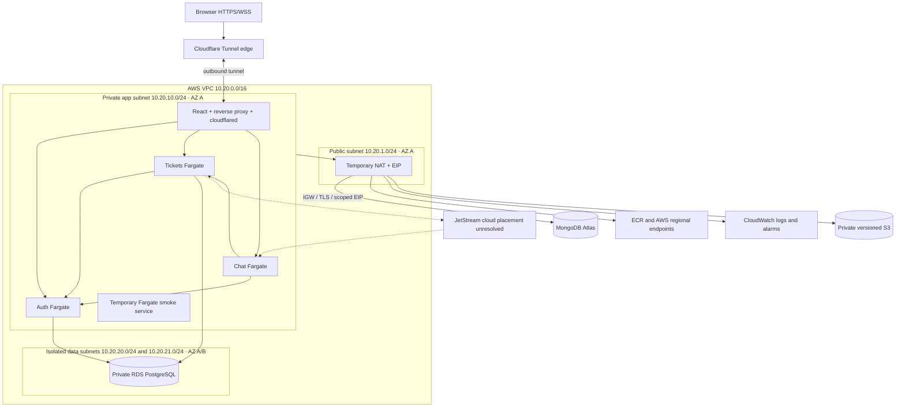

# FixIt — Cloud & Internet Computing | Progress Report No. 1

Keiser University, Latin American Campus · CEN4086 · Fall 2026
Instructor: Dr. Marvin Arias | Draft for evaluation (A–D)

**Status as of November 23:** the user selected ECS Fargate without EC2, a temporary NAT gateway, native CloudFormation and staged provisioning. CloudWatch remains selected. This updates the proposal for Cloud; instructor equivalence, team approval, cloud broker durability, costs and deployment are still pending. No AWS resources were created in this session. Deadline: Friday November 27 at 11:59 PM CST per [Blackboard assignment](https://keiseruniversity.blackboard.com/ultra/courses/_646801_1/assessment/_44237175_1/overview?courseId=_646801_1).

## A. Description of the proposed project

FixIt is an IT Help Desk for a controlled university pilot. It allows authorized users to submit IT incidents, support staff to manage tickets and participants to communicate in a ticket-specific chat. The application is designed around Auth, Tickets, Chat and a React frontend, with PostgreSQL for transactional data and MongoDB for chat messages. NATS JetStream is part of the existing local architecture.

The Cloud objective is to demonstrate infrastructure provisioning, virtual networking, managed compute, secure storage, monitoring, cost estimation and recoverability without maintaining EC2 servers. The academic infrastructure demonstration can run independently from unfinished application modules. This is not a second product and is not a claim that the integrated application is already deployed.

### Target architecture (not deployed)

The dotted broker represents an unresolved runtime dependency, not a hosted service. The smoke service is an independent temporary diagnostic workload, not the final application. AWS regional services and Atlas are outside the VPC. The CloudFormation templates currently implement foundation and smoke only, not the full target diagram.

| Network | CIDR | Route |
| --- | --- | --- |
| VPC | 10.20.0.0/16 | local |
| Public subnet | 10.20.1.0/24 | 0.0.0.0/0 -> IGW |
| Private app subnet | 10.20.10.0/24 | NAT default route only during approved session |
| Isolated data subnet A | 10.20.20.0/24 | local only |
| Isolated data subnet B | 10.20.21.0/24 | local only |

Use two AZs for the future RDS subnet group, not Multi-AZ RDS. Verify CIDR overlap, actual AZ availability and region before deployment. Fargate tasks have no public IP; the smoke security group allows outbound HTTPS only and no inbound access. Future application-specific security groups and IAM roles are not yet implemented. RDS must remain private and allow 5432 only from authorized application roles' SGs. Atlas uses TLS and an explicit NAT EIP allowlist, never 0.0.0.0/0; confirm compatibility with NFR-002 before real use. A new NAT EIP requires an updated Atlas allowlist. Keep local databases for development until a secure remote access path exists; no EC2/SSM jump host or public RDS shortcut.

### Simplification and durable messaging

The user explicitly rejected EC2. Do not use EFS/NFS as a presumed safe JetStream disk, or claim service-managed ECS EBS survives replacement. AWS states that volumes attached to service-managed tasks are deleted upon termination. Standalone Fargate tasks can retain EBS, but reattachment/recovery needs a separate design; it is not transparent service persistence. A managed NATS provider may avoid server maintenance but introduces external cost and connectivity. The application contracts currently rely on durable events, outbox retries and recovery; neither an ephemeral broker nor replacing NATS with another queue is approved. Keep JetStream in local Compose, defer the Cloud broker choice until recovery semantics and budget are validated. The AWS smoke exercise deliberately does not depend on the broker.

### Academic equivalence and evidence

Source: [original Group Project Assignment, Week 9](https://keiseruniversity.blackboard.com/ultra/courses/_646801_1/document/_44237160_1?view=content&state=view), read November 23. Earlier oral feedback reported by the user accepted one VPC/EC2 and S3 versioning. No written approval for the new no-EC2 architecture has been obtained.

| Original step | Proposed evidence | Status |
| --- | --- | --- |
| A1 Root MFA | Screenshot in console, IAM individual access | pending |
| A2 S3 static index.html | Versioned private release artifact and manifest; static page only if still required | confirm substitution; template written |
| A3 Two VPCs and peering | One VPC with public, private and isolated subnet routes; no peering claimed | confirm substitution; template written |
| A4 VM in each VPC and diagram | Fargate service, isolated data subnet group plan, labeled diagram | confirm substitution; diagram/template written |
| A5 ICMP from both VMs | Prove private task outbound access and no public IP, isolated route table; later authorized/unauthorized TCP tests against private RDS | confirm substitution; not executed; not equivalent to literal ICMP |
| A6 VM alarm | ECS service CPUUtilization alarm in CloudWatch | confirm substitution; template written |
| A7 One-year estimate | AWS Pricing Calculator annual scenario plus actual session budget | pending |
| A8 Documentation | Repo templates, validation output, diagrams and actual console evidence when deployed | partial |
| A9 Presentation / A10 Cleanup | Demonstration, export and teardown checklist | pending |

## B. Source code and infrastructure automation

The repository contains application contracts and local prototypes; integrated application release is pending. Two actual CloudFormation templates have been written:

- [foundation.json](../infra/cloudformation/foundation.json): VPC, four subnets, three route tables, IGW, outbound-only smoke SG, ECS cluster, four immutable ECR repositories and private encrypted/versioned S3 bucket. No NAT, IP allocation, DB, compute task or alarm.
- [session-smoke.json](../infra/cloudformation/session-smoke.json): temporary zonal NAT/EIP, private default route, minimal log execution role, Fargate task definition/service (default desired count 0), 7-day log group and CPU alarm. This stack incurs NAT/IP/monitoring costs even with zero tasks. Set desired count 1 only after approval.
- [Runbook](../infra/cloudformation/README.md): validation, deployment preconditions, evidence and teardown.

Future release workflow: GitHub Actions builds and pushes immutable images to ECR after approved tests; use a restricted OIDC deploy role, pin release digests, run migrations once using separate credentials, update task definitions, record SHA/digests in S3, verify health and application behavior. Rollback requires compatible DB schema and previous image digests. The workflow, RDS, full app runtime and broker are not implemented by these templates. No secrets are committed.

## C. Short literature survey (draft)

Cloud computing provides on-demand, measured infrastructure and services. NIST SP 800-145 identifies IaaS, PaaS and SaaS as distinct service models. Fargate is a managed container compute model that reduces host administration; the team remains responsible for application code, dependencies, IAM and data. AWS's shared responsibility model separates AWS's infrastructure responsibility from the customer's workload configuration.

Network segmentation reduces unnecessary exposure. A VPC with distinct public, private and isolated routes permits controlled outbound access without assigning public addresses to application tasks. NAT provides egress, not a public entry point. Security groups control authorized traffic, while application authorization remains necessary. RDS's private placement and separate credentials further constrain access.

Infrastructure as Code captures infrastructure definitions as reviewable, repeatable configuration. CloudFormation change sets expose proposed resource changes before execution. ECS services manage container task lifecycles; stateful workload persistence is a separate requirement. S3 object versioning preserves release history, not live database state. CloudWatch service metrics and logs support observability and cost-aware operation. References are below; final literature survey requires review and citations in the submitted format.

## D. Improvement over a manual deployment

Staged CloudFormation is the selected improvement: separate inexpensive foundation definitions from a time-limited runtime. This makes network and storage configuration repeatable, prevents unintentional compute activation and supports version-controlled review. The implemented template defaults to no Fargate tasks. S3 blocks public access, encrypts and versions releases; ECR uses immutable tags; the smoke stack defines an ECS CPU alarm. Implementation means configuration files exist, not that AWS deployment has succeeded.

### Cost and operational limits

USD 120 accumulated AWS consumption against confirmed credits, no personal spending or plan upgrade. Foundation has no intentionally running billable compute/NAT/RDS resources, but S3 requests/storage, ECR images/scanning and other usage can incur charges; check eligibility first. The smoke session incurs NAT hourly/GB, IPv4, Fargate while running, CloudWatch and data-transfer costs. Deleting the session stack removes the NAT/EIP/route and temporary monitoring/compute, but first scale to zero and export evidence. Retained release bucket/ECR repositories require explicit cleanup later. RDS (future) incurs storage charges when stopped and restarts after seven days. Atlas billing is separate. Do not confuse annual hypothetical cost with actual short-term credit usage. No calculator export or confirmed credit balance yet.

### Milestones

| Date | Evidence |
| --- | --- |
| Nov 23 | Decisions, diagrams, CloudFormation source and local checks |
| Nov 24 | Show instructor proposal; confirm rubric substitutions and account/credits; review cost |
| Nov 25–26 | If explicitly authorized: foundation, smoke session, real screenshots, teardown, annual Calculator estimate and review A–D; full app remains separate |
| Nov 27 | Submit report before 11:59 PM CST |

## References

- [NIST SP 800-145](https://csrc.nist.gov/pubs/sp/800/145/final), [AWS shared responsibility](https://aws.amazon.com/compliance/shared-responsibility-model/).
- [CloudFormation pricing](https://aws.amazon.com/cloudformation/pricing/), [CloudFormation ECS examples](https://docs.aws.amazon.com/AmazonECS/latest/developerguide/working-with-templates.html).
- [Fargate pricing](https://aws.amazon.com/fargate/pricing/), [ECS task networking](https://docs.aws.amazon.com/AmazonECS/latest/developerguide/fargate-task-networking.html), [ECS EBS lifecycle](https://docs.aws.amazon.com/AmazonECS/latest/developerguide/ebs-volumes.html), [ECS EBS termination configuration](https://docs.aws.amazon.com/AmazonECS/latest/developerguide/configure-ebs-volume.html), [ECS CloudWatch metrics](https://docs.aws.amazon.com/AmazonECS/latest/developerguide/available-metrics.html), [VPC pricing](https://aws.amazon.com/vpc/pricing/).
- [Atlas private endpoint](https://www.mongodb.com/docs/atlas/security-private-endpoint/), [Atlas IP access list](https://www.mongodb.com/docs/atlas/security/ip-access-list/), [NATS JetStream](https://docs.nats.io/concepts/jetstream), [RDS stop](https://docs.aws.amazon.com/AmazonRDS/latest/UserGuide/USER_StopInstance.html).
- Existing project background: [004.Cloud](004.Cloud.md), [015.Hybrid-Development](015.Hybrid-Development.md), [011.Gates](011.Gates.md). Earlier EC2 topology is historical, not the user's current Cloud direction.
