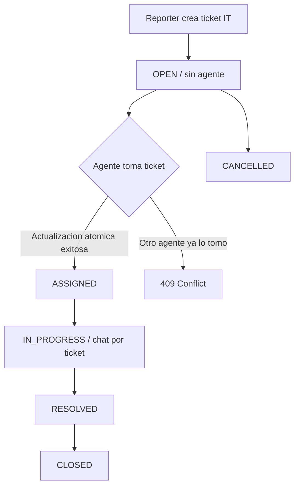

# FixIt IT Help Desk — requisitos provisionales

**Estado:** borrador de trabajo, 9 de noviembre de 2026. No aprobado por el grupo.
**Fuentes:** conversaciones de planificacion del equipo; propuesta original en [PDF](references/FixIt_Project_Specification.pdf), especialmente pp. 3–6, 9–10, 13–16.

## Proposito

Centralizar solicitudes de **soporte tecnico IT**: red/Wi-Fi, software, hardware, cuentas/acceso, proyectores y perifericos. Un usuario reporta un incidente, un agente de soporte lo toma, ambos conversan dentro del ticket y registran su resolucion.

La aplicacion debe permitir demostrar conceptos de Web Development II y servir como producto real para desplegar en Cloud Computing, sin intentar cubrir mantenimiento de edificios, electricidad, plomeria u otras categorias no IT.

## Acuerdos provisionales alcanzados

1. **Un ticket es el eje del producto.** La conversacion pertenece a ese ticket; no se desarrolla por ahora un chat libre independiente.
2. **Los agentes pueden tomar tickets disponibles.** Un agente no puede apropiarse de un ticket ya asignado; la comprobacion debe ocurrir en el servidor y en una operacion atomica.
3. **Tres roles funcionales:** Reporter, Support Agent y Admin. Las acciones visibles en React no reemplazan autorizacion en el servidor.
4. **Actualizaciones en vivo:** Socket.io para mensajes y notificaciones; REST para crear/consultar/cambiar el estado persistente. Los webhooks externos no son necesarios en el MVP.
5. **Dos bases como posibilidad preferida:** PostgreSQL para identidades, tickets, asignacion y cambios de estado criticos; MongoDB para historial de mensajes. No se considera irrevocable si el costo tecnico resulta excesivo.
6. **AI Smart Triage no bloquea el reporte.** Se retira del nucleo del MVP; podria evaluarse despues de un flujo de tickets estable.

## Flujo funcional propuesto

**Estado de este flujo:** propuesta. La posibilidad de reabrir, reasignar, confirmar o cerrar automaticamente un ticket sigue abierta. Para la demo se puede usar el recorrido completo sin implementar estados excepcionales.

### Autoasignacion sin carreras

La operacion conceptual es: actualizar `assigneeId` y estado a `ASSIGNED` **solo si** el ticket sigue `OPEN` y sin asignar. Si no se actualiza ninguna fila por competencia entre agentes, responder `409 Conflict`. El control debe estar en la base de datos (actualizacion condicionada/transaccion), no en una comprobacion previa hecha solo desde React. El evento de auditoria critico debe persistirse junto al cambio; Socket.io se notifica tras confirmar el cambio.

## Matriz inicial de permisos

| Accion | Reporter | Support Agent | Admin |
| --- | --- | --- | --- |
| Crear ticket | Si | Si | Si |
| Listar/ver tickets | Propios | Asignados y disponibles sin asignar | Todos |
| Tomar ticket OPEN sin agente | No | Si, atomicamente | A definir |
| Leer/escribir chat | Propios autorizados | Tickets asignados | Todos |
| Cambiar estado a IN_PROGRESS / RESOLVED | No | Asignados | Si |
| Confirmar cierre de RESOLVED | Propios | No | Si |
| Cancelar OPEN | Propios | No | Si |
| Reasignar agente | No | No | Si |
| Administrar usuarios / catalogos | No | No | Si |

**Invariantes de seguridad:** autenticacion requerida salvo registro/login; RBAC y ownership validados en el backend y en la conexion a Socket.io; un agente puede descubrir tickets abiertos disponibles, pero no leer chats ni datos privados de tickets ajenos. Verificar que el flujo de reasignacion invalide permisos anteriores.

## MVP que proponemos discutir con el equipo

- Registro e inicio/cierre de sesion, password hashing, cookies/JWT o sesiones segun decision posterior, RBAC.
- Crear, listar, filtrar y consultar tickets; prioridad, categoria, estado, propietario y agente.
- Agentes pueden tomar tickets libres; un administrador puede intervenir o reasignar.
- Chat 1:1 o de participantes autorizados dentro de un ticket, con mensajes guardados y recepcion en vivo.
- Cambios de estado, timeline auditado, validacion, errores consistentes y pruebas de autorizacion/concurrencia.
- Documentacion de API y despliegue reproducible para la entrega.

### Fuera del nucleo inicial

- Triage por IA, clasificacion automatica de riesgos fisicos, fotografia obligatoria, flujos de emergencia, reportes avanzados, SLA automatizados, multiempresa, inventario, correo/SMS y webhooks externos.
- Estos puntos **no desaparecen del documento original**; quedan para reconsiderar si sobra tiempo o si algun requisito del curso los exige.

## Criterios de aceptacion sugeridos

1. Un reporter autenticado crea un ticket IT y visualiza su estado.
2. Dos agentes que intentan tomar el mismo ticket simultaneamente no logran duplicar la asignacion: uno recibe exito y el otro `409`.
3. El reporter, el agente asignado y el admin pueden usar el chat; un tercero no autorizado no puede leer ni publicar mensajes.
4. Tras reconectar Socket.io, el historial se reconstruye desde almacenamiento persistente, no de memoria de sockets.
5. El agente resuelve el ticket; el reporter puede confirmar el cierre; cada cambio conserva autor y fecha.
6. Una caida del canal en tiempo real no pierde la escritura confirmada en la fuente de verdad.

## Decisiones que faltan

- Identidad de la organizacion objetivo: universidad/empresa ficticia y categorias exactas.
- Confirmacion de si React, Prisma y MongoDB son requisitos del profesor o elecciones del grupo.
- Modelo exacto de autenticacion: JWT en cookie, rotacion/revocacion, CSRF y sesion alternativa.
- Comportamiento de chat antes de asignacion; archivos adjuntos; paginacion; retencion de mensajes.
- Si el Admin puede tomar tickets como agente, si los tickets RESOLVED pueden reabrirse y quien cierra por inactividad.
- Estrategia de consistencia entre PostgreSQL y MongoDB, limites de costos y respuesta ante caida de cualquiera.
